# 青年传媒中心系统分析与设计课程作业

## 1 拟开发项目的愿景

### 1.1 愿景一句话

减少青年传媒中心每周津贴统计的人工整理耗时。

### 1.2 愿景要素

| 要素 | 内容 |
| --- | --- |
| 系统 | 青年传媒中心工作统计与协作系统 |
| 目标组织 | 青年传媒中心 |
| 老大 | 指导老师 |
| 目标 | 减少每周津贴统计的人工整理耗时 |
| 度量指标 | 办公部每周人工收集、核对和汇总工作量记录所用的总人时（分钟/周） |
| 对比时间 | 系统使用前的现状时期（2026 年 9 月访谈，约 60 分钟/周） |
| 改进值 | 每周人工整理耗时低于 60 分钟；具体下降幅度由试运行数据验证 |

### 1.3 度量口径

在相近任务量和人员规模下，比较系统使用前后的周统计人工耗时；均包含收集、核对与汇总，不包含稿件发布、拍摄以及等待审核的时间。约 60 分钟是访谈估计基线，后续用同一口径记录实际耗时。

## 2 业务建模

### 2.1 组织职责与业务边界

目标组织为整个青年传媒中心，业务责任范围为“宣传服务、工作协作与津贴核算”。对外提供稿件挂网、摄制、推文和美编服务，对内提供可核对的工作量和津贴统计依据。

| 部门／岗位 | 主要业务职责 |
| --- | --- |
| 办公部 | 为采编部和外部门稿件挂网；指定成员归档摄制成果；部长组织津贴统计并生成中心周报 |
| 摄制部 | 完成拍摄、制作；通过部长派发或已开放任务的抢单取得任务 |
| 采编部 | 采写稿件，为办公部挂网、运营部推文提供稿件材料；承担稿件审核相关工作 |
| 运营部 | 转发外部门推文，自行写稿制作推文；部长负责推文一审 |
| 美编部 | 为各部门及其他需求人员提供绘画、设计成果 |
| 原创部 | 承担与运营部相近、相对自足的内容生产工作 |
| 各部门部长／干事 | 部长派发任务或依排班表安排；干事承担任务执行 |
| 指导老师 | 对稿件进行二审，审查内容、表述与政治性 |
| 小程序管理员 | 维护组织、人员及系统使用条件 |

“外部门”指需要青年传媒中心协助的其他人员或机构。内部部门既可能提出服务需求，也可能承办另一项业务。业务执行者按所请求服务的责任边界识别；内部承办岗位及协作步骤在序列图中展开，不因参与工作就一律画作业务执行者。

### 2.2 业务用例图

| 编号 | 业务用例 | 主要业务执行者 | 主要承办职责 |
| --- | --- | --- | --- |
| BU-01 | 办理稿件挂网与同步 | 稿件提供方（采编部、外部门） | 办公部完成挂网／同步，指导老师审核 |
| BU-02 | 提供摄制服务 | 摄制需求方（中心成员、外部门） | 摄制部完成摄制，指定办公成员归档 |
| BU-03 | 提供个人工作量核算结果 | 工作量核对方（中心成员） | 各部门核对本部门贡献 |
| BU-04 | 提供中心津贴统计依据 | 统计需求方（指导老师） | 办公部部长生成中心周报 |
| BU-05 | 提供推文制作与转发服务 | 推文需求方（中心部门、外部门） | 运营部承办，部长一审、指导老师二审；原创部承担自身内容生产 |
| BU-06 | 提供美编设计服务 | 美编需求方（各部门及其他需求人员） | 美编部承办 |

[业务用例图源文件](diagrams/business-use-case.puml)

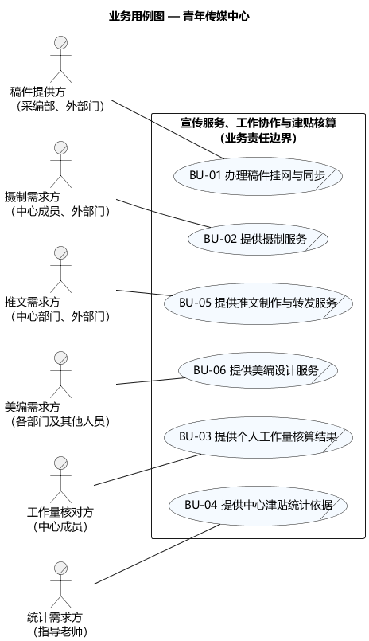

同一需求方角色可由不同的人或机构扮演。图中连线表示接受服务，不表示该执行者负责所有内部环节；跨部门流转是完成上述业务的协作方式。

### 2.3 现状业务序列图

#### 2.3.1 稿件挂网与同步的人工协同基线

[图源](diagrams/current-business-sequence-editorial-office.puml)

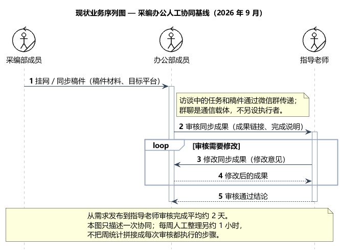

本图依据 2026 年 9 月访谈描述的人工协同：采编部成员在微信群发布任务与稿件，办公部成员完成挂网或同步后请指导老师审核。外部门也是办公部稿件来源，本图选取信息完整的采编来源实例。群聊是通信载体，稿件是传递的材料。从发布需求到老师审核完成平均约 2 天；此数据不是拟开发系统的周期承诺。

#### 2.3.2 每周津贴统计的人工整理片段

[图源](diagrams/current-business-sequence-weekly-statistics.puml)

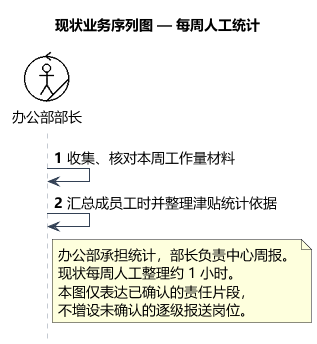

办公部承担津贴统计，部长负责中心周报。现状每周人工收集、核对和汇总工作量约耗时 1 小时。图中只展开已确认的统计责任，不假定具体表格软件或尚未说明的逐级审批链。统计与单项任务发生频率不同，因此单独建模。

### 2.4 改进业务序列图

#### 2.4.1 采编办公协同

[图源](diagrams/improved-business-sequence-editorial-office.puml)

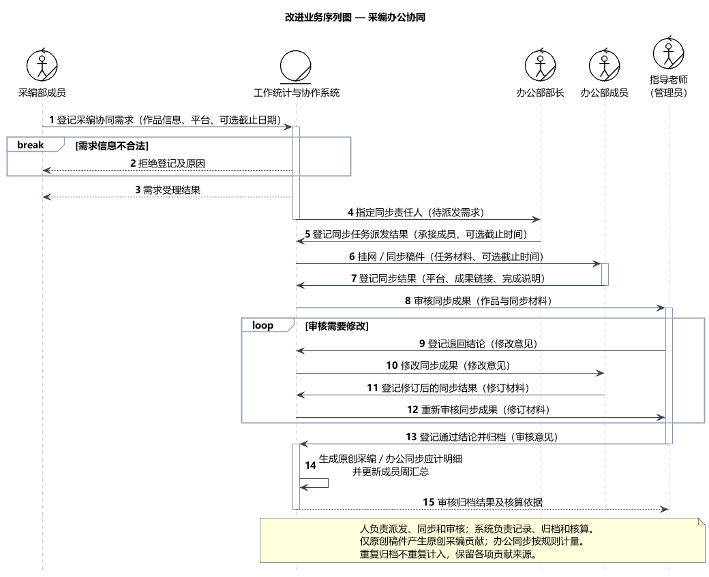

采编成员提交需求，办公部部长派发，指定干事完成同步，指导老师审核，系统按通过结论归档。需求保留标题、作品名称、原创／转载类型、平台，截止日期可选。原创采编贡献与办公同步贡献分别计量；转载不能自动产生原创写作贡献。该专门流程依照小程序截图建模，不额外插入未经确认的一审岗位。

#### 2.4.2 摄制预约、承接与归档

[图源](diagrams/improved-business-sequence-production-booking.puml)

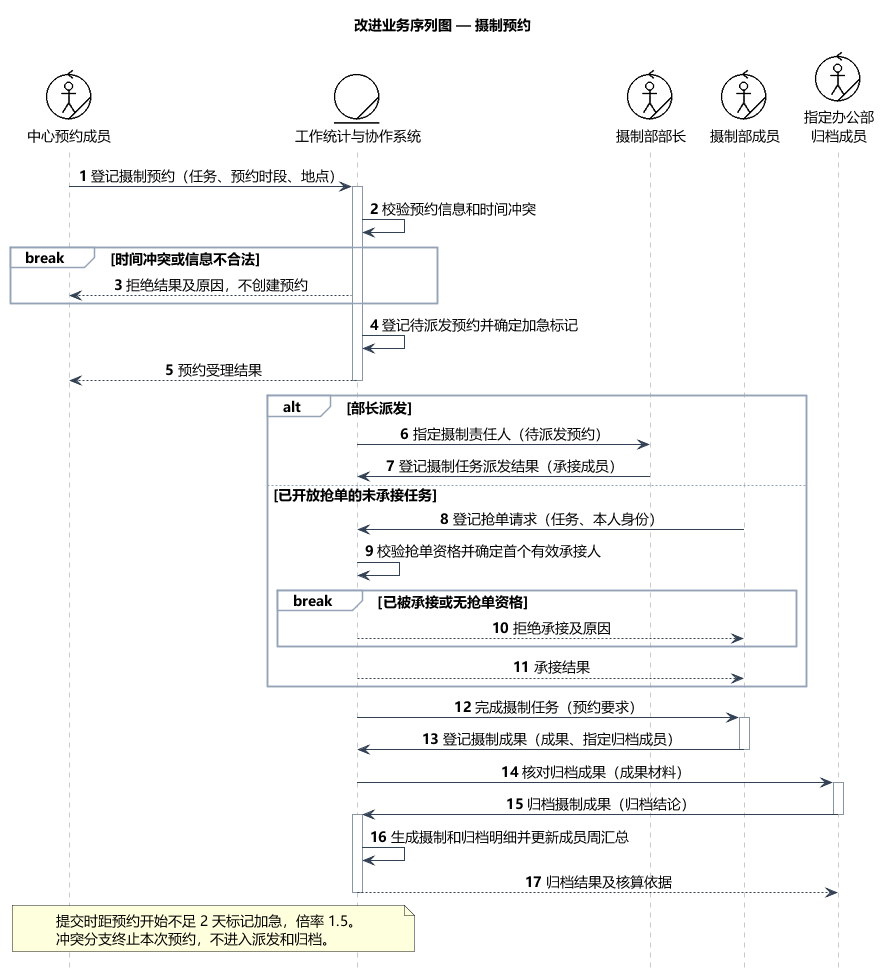

中心成员提出预约；系统先检查时间冲突，有冲突则拒绝且不创建预约。提前不足 2 天标记加急，倍率为 1.5。承接采用部长派发，或由成员抢取已开放任务，两者不能给同一任务形成两个当前负责人。摄制成员提交成果并指定办公归档成员，后者确认归档；摄制和归档工时分别计入对应成员记录。外部门是服务需求来源，其需求接入与中心成员预约身份分别识别。

#### 2.4.3 其他部门及跨部门任务流转

[图源](diagrams/improved-business-sequence-general-workflow.puml)

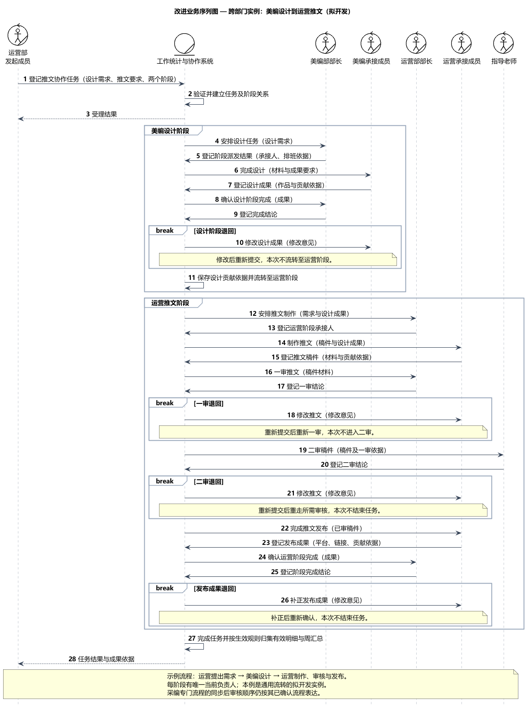

拟开发流程按“任务—阶段—责任人—成果”组织：发起成员登记需求和参与部门，相关部长派发本部门阶段，承接成员提交成果，阶段完成后流转至下一部门。同一任务允许跨多个部门，每个阶段明确一个当前负责人。美编设计、采编供稿、运营推文可组合成一项流转任务；只有一个部门时同样适用。

图 6 选取“运营部提出需求—美编部设计—运营部制作与发布推文”的具体实例，按“发起成员编排阶段、部门部长确认阶段完成”的拟开发方案展开。推文稿件增加运营部部长一审和指导老师二审，普通设计任务不因此强制增加稿件审查。阶段完成确认与稿件内容审核分别表达；同一项审核不因使用通用流转而重复执行。原创部可按自身业务设置单部门阶段，不机械复制运营部的全部岗位安排。

#### 2.4.4 每周津贴统计

[图源](diagrams/improved-business-sequence-weekly-statistics.puml)

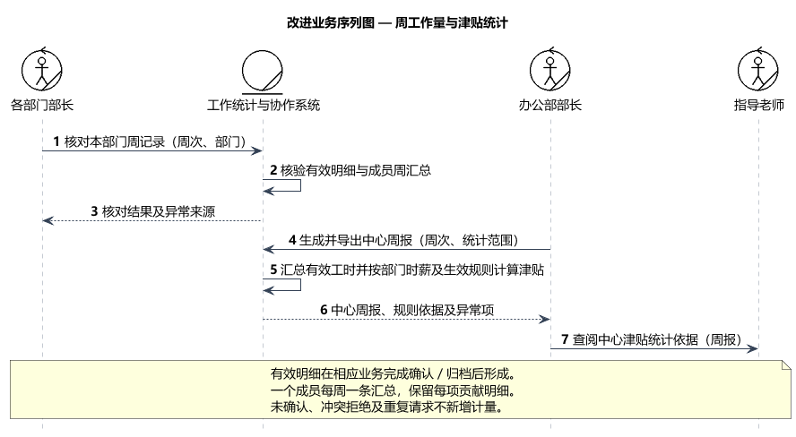

归档或完成确认产生带来源的有效任务明细，系统形成每成员每周一条汇总。各部长核对本部门记录，办公部部长生成、导出中心周报；系统结合部门时薪和生效规则计算津贴。异常数据保留来源供复核，不补造贡献、不重复计量。系统减少收集与汇总的重复劳动，人的确认和审核责任保留。

### 2.5 符号与责任

圆内小人为业务工人，空圆带斜线和下划线为业务实体；目标软件为新增业务实体。实线“A → B：动作”表示 A 请求 B 执行该动作；虚线返回结果；自消息表达自身责任。文档、微信群和成果链接不作为能派发、审核的人员。

### 2.6 业务与系统用例映射

| 业务来源 | 系统责任／用例 |
| --- | --- |
| BU-01 采编来源 | UC-ED-001～004：需求、派发、结果、审核归档 |
| BU-01 外部门来源，BU-05，BU-06 | UC-FL-001～004：登记流转任务、派发阶段、提交成果、确认阶段；稿件审查使用 UC-RV-001／002 |
| BU-02 | UC-PR-001～005：预约、派发、成果、归档、抢单 |
| BU-03 | UC-VIEW-001：个人记录；UC-REC-001：部门核对 |
| BU-04 | UC-STAT-001：办公部部长生成／导出中心周报 |
| 组织支撑 | UC-ORG-001：组织人员维护；UC-AUTH-001：身份验证 |

系统用例分业务视图展开，见下一节；每个用例对应同编号规约。

## 3 系统用例图

总图展示同一个目标系统的完整用例范围，后续三个视图按业务展开。账号角色仍为管理员、部长、普通成员；部门、承接关系和业务职责限定具体工作。

### 3.1 系统用例总图

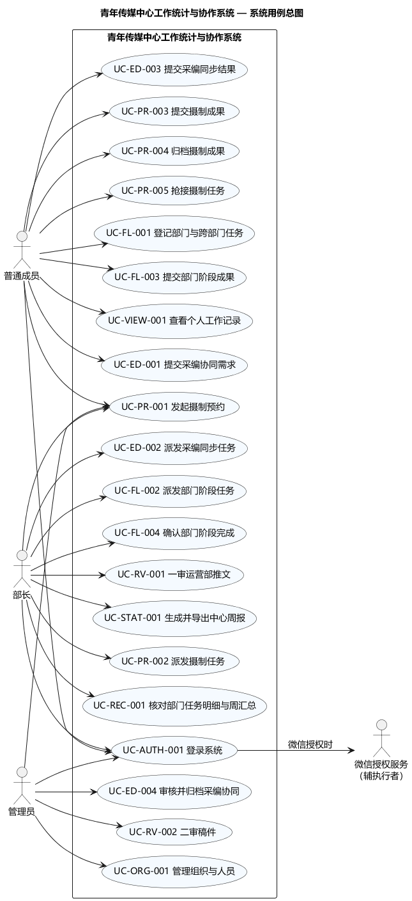

[PlantUML 源文件](diagrams/system-use-case-overview.puml) · [矢量图](diagrams/system-use-case-overview.svg)

矩形表示目标软件边界，执行者位于边界外，椭圆表示系统向执行者提供的服务。总图包含 19 个核心业务用例及 1 个公共登录用例，编号与第 4 节规约一一对应。

普通成员、部长、管理员为主执行者，箭头由执行者指向其发起的用例。微信授权服务为登录时使用的辅执行者，箭头由登录用例指向该服务；凭据登录路径不依赖微信授权。箭头表达主／辅参与方向，不表达工作流程先后顺序。

| 系统执行者 | 具体业务职责约束 |
| --- | --- |
| 普通成员 | 采编成员提交协同需求；办公承接成员提交同步结果；摄制成员抢单及提交成果；指定办公成员归档摄制；任务发起人登记流转任务、阶段承接人提交成果；查看本人记录 |
| 部长 | 办公部长派发同步任务并生成中心周报；摄制部长派发摄制任务；各部长派发、确认本部门阶段并核对本部门记录；运营部长一审推文 |
| 管理员 | 指导老师承担稿件审核职责；维护管理员管理组织人员，具体审核授权仍按业务职责区分 |
| 微信授权服务 | 在微信授权登录路径中协助身份验证，不承担中心的业务审批 |

摄制预约向任何中心成员开放，所以三个角色均关联该用例；登录也是共享用例。其余用例按主要职责关联，部门和当前任务责任进一步限定范围。未确定直接登录方式的外部门需求方暂不增加为系统执行者。

系统用例从改进业务序列图中“外部人员请求目标系统完成的服务”映射得到，例如“登记同步派发结果”对应“派发采编同步任务”，“归档摄制成果”对应同名用例。“形成明细、更新周汇总”等系统内部处理保留为相关用例的步骤和后置条件，不单独画作执行者发起的用例。登录和组织维护属于公共支撑需求。

### 3.2 稿件协同与摄制

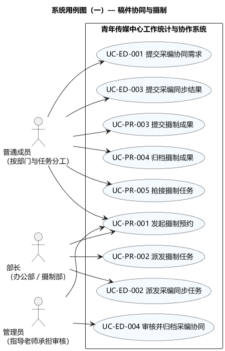

[PlantUML 源文件](diagrams/system-use-case.puml)

采编需求提交、办公派发、同步结果提交和老师审核分别对应用例；摄制增加抢单，用唯一承接结果衔接成果提交与办公归档。“任何中心成员预约”包括部长和管理员以预约人身份参与；图展示主要职责，不以简化连线收紧真实业务资格。

### 3.3 部门与跨部门流转

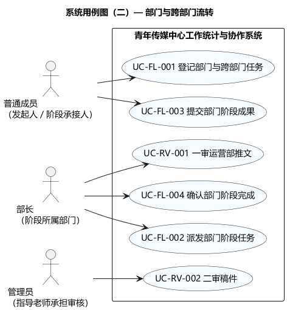

[PlantUML 源文件](diagrams/system-use-case-workflow.puml)

通用任务按阶段分配职责，用于覆盖推文、美编和其他跨部门工作。推文一审与稿件二审独立表达，部门阶段完成确认不替代内容审核；老师审核不因使用通用任务再重复执行一次。外部门是业务服务对象，软件入口取决于实际账号安排，不能直接新增第四类账号角色。

### 3.4 工作量统计与组织支撑

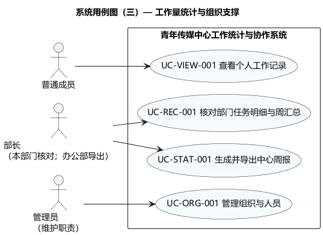

[PlantUML 源文件](diagrams/system-use-case-statistics.puml)

办公部部长负责中心周报，各部门部长负责本部门记录核对；普通成员查看本人工作记录；管理员维护组织人员。指导老师对稿件审核和索取统计依据的业务职责，与维护管理员区别说明。任务明细、周汇总和自动计量属于系统处理及后置条件，不将系统自身当作外部执行者。

## 4 系统用例规约

### 4.1 用例目录

| 编号 | 用例 | 主要执行者 |
| --- | --- | --- |
| UC-AUTH-001 | 登录系统 | 普通成员、部长、管理员；微信授权服务为外部辅助系统 |
| UC-ED-001 | 提交采编协同需求 | 普通成员（采编部） |
| UC-ED-002 | 派发采编同步任务 | 部长（办公部） |
| UC-ED-003 | 提交采编同步结果 | 普通成员（办公部） |
| UC-ED-004 | 审核并归档采编协同 | 管理员（指导老师） |
| UC-PR-001 | 发起摄制预约 | 中心预约成员（以普通成员为主要执行者，部长、管理员亦可作为预约人） |
| UC-PR-002 | 派发摄制任务 | 部长（摄制部） |
| UC-PR-003 | 提交摄制成果 | 普通成员（摄制部） |
| UC-PR-004 | 归档摄制成果 | 普通成员（办公部归档成员） |
| UC-PR-005 | 抢接摄制任务 | 普通成员（摄制部） |
| UC-FL-001 | 登记部门与跨部门任务 | 普通成员（任务发起成员） |
| UC-FL-002 | 派发部门阶段任务 | 部长（当前阶段所属部门） |
| UC-FL-003 | 提交部门阶段成果 | 普通成员（当前阶段承接成员） |
| UC-FL-004 | 确认部门阶段完成 | 部长（当前阶段所属部门） |
| UC-RV-001 | 一审运营部推文 | 部长（运营部） |
| UC-RV-002 | 二审稿件 | 管理员（承担审核职责的指导老师） |
| UC-REC-001 | 核对部门任务明细与周汇总 | 部长 |
| UC-STAT-001 | 生成并导出中心周报 | 部长（办公部） |
| UC-ORG-001 | 管理组织与人员 | 管理员 |
| UC-VIEW-001 | 查看个人工作记录 | 普通成员 |

### UC-AUTH-001：登录系统

#### 基本信息

| 项目 | 内容 |
| --- | --- |
| 执行者 | 普通成员、部长、管理员；微信授权服务为外部辅助系统 |
| 触发事件 | 用户需要访问系统业务 |
| 前置条件 | 账号已注册且处于有效状态 |
| 后置条件 | 系统建立有效会话并返回执行者角色和部门范围；失败时不建立会话 |
| 涉众利益 | 成员获得与职责相符的工作范围；管理员保证身份和权限不被冒用 |

#### 基本路径

1. 执行者提交登录凭据或微信授权凭据。
2. 系统验证凭据、账号状态、角色和部门关系。
3. 系统建立有效会话并反馈登录结果。

#### 扩展路径

- 1a. 微信账号未绑定：系统反馈绑定或注册所需条件。
- 2a. 凭据不正确、账号不存在或账号停用：系统拒绝登录并说明原因。
- 2b. 角色和部门关系不合法：系统拒绝建立会话。

#### 字段列表

登录凭据、微信授权凭据、角色、部门、账号状态、会话有效期。

#### 业务规则

- 有效账号的姓名按当前账号规则识别，重名处理以组织的账号规则为准。
- 普通成员和部长必须关联有效部门；管理员可以不关联部门。
- 会话失效后，执行者不能继续访问受保护业务。

#### 质量需求

- 登录失败时不建立有效会话；无效凭据不能获得受保护业务的访问权限。
- 系统不得明文保存或反馈密码。

### UC-ED-001：提交采编协同需求

#### 基本信息

| 项目 | 内容 |
| --- | --- |
| 执行者 | 普通成员（采编部） |
| 触发事件 | 采编部完成稿件并提出同步需求 |
| 前置条件 | 执行者已登录且属于采编部；采编办公协同职责已启用 |
| 后置条件 | 系统建立一条待办公部派发的采编协同，保存发起人和需求信息 |
| 涉众利益 | 采编成员希望需求被完整接收；办公部部长希望获得可派发的任务；管理员希望后续统计有明确来源 |

#### 基本路径

1. 采编部普通成员提交协同标题、作品名称、稿件材料、原创或转载类型、投稿平台及可选截止日期。
2. 系统验证需求信息完整性、发起权限及已提供截止日期的有效性。
3. 系统登记采编协同，将其置为待办公部派发，并反馈受理结果。

#### 扩展路径

- 1a. 需求信息缺失：系统拒绝登记并反馈缺失内容。
- 2a. 执行者不属于采编部或已提供的截止日期不合法：系统拒绝登记并反馈原因。

#### 字段列表

发起人、标题、作品名称、稿件材料、原创或转载类型、投稿平台、截止日期、状态、时间线。

#### 业务规则

- 采编协同必须有可识别的来源成员；截止日期为可选信息，未设置不阻止受理。
- 作品名称、投稿平台、原创或转载类型和成果链接属于归档所需业务信息。

### UC-ED-002：派发采编同步任务

#### 基本信息

| 项目 | 内容 |
| --- | --- |
| 执行者 | 部长（办公部） |
| 触发事件 | 办公部收到待派发稿件需求 |
| 前置条件 | 执行者是办公部部长；存在待派发采编协同；办公部成员可承担任务 |
| 后置条件 | 系统登记一名办公部承接成员、已约定的截止时间和派发结果，协同进入待同步状态 |
| 涉众利益 | 部长希望责任明确；办公部成员希望知道承担的任务；采编成员希望需求被及时接收 |

#### 基本路径

1. 办公部部长提交采编协同的承接成员及可选截止时间。
2. 系统验证部长权限、承接成员归属及已提供截止时间的有效性。
3. 系统登记派发结果并将协同置为待同步，向承接成员交付任务要求并反馈派发结果。

#### 扩展路径

- 1a. 没有合适承接成员或已提供的截止时间不合法：系统拒绝派发并反馈原因。
- 2a. 协同已经被处理或不属于办公部职责：系统拒绝派发。

#### 字段列表

协同标识、承接成员、截止时间、派发说明、派发时间、状态。

#### 业务规则

- 一个待派发协同只能有一个当前承接成员。
- 只有办公部部长可以派发办公部同步任务。

### UC-ED-003：提交采编同步结果

#### 基本信息

| 项目 | 内容 |
| --- | --- |
| 执行者 | 普通成员（办公部） |
| 触发事件 | 办公承接成员完成同步或完成退回修改 |
| 前置条件 | 执行者是当前承接成员；协同处于待同步或退回修改状态 |
| 后置条件 | 系统保存同步结果并将协同置为待管理员审核 |
| 涉众利益 | 承接成员希望完成情况可追踪；管理员希望审核依据完整；采编成员希望得到成果链接 |

#### 基本路径

1. 办公部普通成员提交同步平台、成果链接和完成说明。
2. 系统验证执行者责任、结果完整性和协同状态。
3. 系统登记同步结果，将协同置为待管理员审核，并反馈提交结果。

#### 扩展路径

- 1a. 成果说明或成果链接缺失：系统拒绝提交并反馈缺失内容。
- 2a. 执行者不是当前承接成员或协同状态不允许提交：系统拒绝提交。

#### 字段列表

承接成员、同步平台、成果链接、完成说明、完成时间、状态。

#### 业务规则

- 同步结果必须与一条有效采编协同关联。
- 退回修改后重新提交必须保留原协同和责任时间线。

### UC-ED-004：审核并归档采编协同

#### 基本信息

| 项目 | 内容 |
| --- | --- |
| 执行者 | 管理员（指导老师） |
| 触发事件 | 同步成果进入待审核状态 |
| 前置条件 | 指导老师以管理员账号登录；协同处于待管理员审核状态 |
| 后置条件 | 通过时协同归档并按规则形成任务明细和成员周汇总；退回时保留上下文并进入退回修改 |
| 涉众利益 | 指导老师希望审核有完整依据；成员希望工作被准确计入；管理员希望统计不重复、不漏记 |

#### 基本路径

1. 指导老师提交审核通过结论和审核意见。
2. 系统验证指导老师审核职责及账号权限、审核材料完整性和当前状态。
3. 系统登记审核结论并归档协同。
4. 系统按生效规则形成应计任务明细，更新相关成员周汇总并反馈归档结果。

#### 扩展路径

- 1a. 退回结论缺少修改意见：系统拒绝保存该结论。
- 2a. 同步结果不完整：系统拒绝归档并反馈缺失内容。
- 1b. 指导老师提交退回结论和修改意见：系统记录退回原因并通知承接成员修改；该成员通过 UC-ED-003 重新提交后再进入本用例，不产生归档明细。
- 4a. 重复归档请求：系统保持原明细和周汇总，不重复计入。

#### 字段列表

审核结论、审核意见、审核人、审核时间、归档时间、规则版本、任务明细、周汇总。

#### 业务规则

- 按截图流程，在同步成果提交后由指导老师审核；不据此推定其他部门稿件也采用同步后审核。
- 原创采编稿件贡献与办公同步贡献分别核算；转载稿件不能自动产生原创采编贡献。
- 本用例由承担稿件审核职责的指导老师执行；技术维护管理员不因账号角色名称自动承担此职责。
- 同一来源任务、应计贡献类型和成员组合只能形成一条有效任务明细。
- 已归档协同不能再次生成同一组合的任务明细。

### UC-PR-001：发起摄制预约

#### 基本信息

| 项目 | 内容 |
| --- | --- |
| 执行者 | 中心预约成员（以普通成员为主要执行者，部长、管理员亦可作为预约人） |
| 触发事件 | 中心成员需要预约摄制服务 |
| 前置条件 | 执行者已登录；摄制预约职责已启用 |
| 后置条件 | 无时间冲突时建立待摄制部派发预约；有冲突时不创建预约 |
| 涉众利益 | 预约人希望获得可执行的摄制安排；摄制部希望避免时间冲突和临时遗漏 |

#### 基本路径

1. 预约成员提交任务名称、预约时段、地点、联系方式和任务要求。
2. 系统验证预约信息、发起权限和有效预约的时间冲突。
3. 系统在无冲突时登记待派发预约，按提交时距预约开始的时间确定加急标记与倍率，并反馈受理结果。

#### 扩展路径

- 2a. 与有效预约时间冲突：系统拒绝预约并反馈冲突信息，不创建预约。
- 2b. 预约信息不完整：系统拒绝登记并反馈缺失内容。

#### 字段列表

预约人、任务名称、预约时段、地点、联系方式、任务要求、加急标记、状态、时间线。

#### 业务规则

- 时间冲突时不能创建待派发预约。
- 加急以本次预约提交时间为基准判断；提前不足 2 天时倍率为 1.5，不在归档时重新按剩余时间判断。

### UC-PR-002：派发摄制任务

#### 基本信息

| 项目 | 内容 |
| --- | --- |
| 执行者 | 部长（摄制部） |
| 触发事件 | 摄制部有待派发预约 |
| 前置条件 | 执行者是摄制部部长；存在待派发预约 |
| 后置条件 | 系统登记一名摄制部承接成员，预约进入待完成状态 |
| 涉众利益 | 摄制部长希望合理安排任务；摄制成员希望责任和要求明确；预约人希望得到承接结果 |

#### 基本路径

1. 摄制部部长提交预约的承接成员。
2. 系统验证部长权限、成员归属和预约状态。
3. 系统登记承接责任，将预约置为待摄制完成，交付任务要求并反馈派发结果。

#### 扩展路径

- 1a. 没有可承接成员：系统保持待派发状态并反馈原因。
- 2a. 预约已被派发或被成员抢单：系统拒绝重复派发并反馈当前承接状态。

#### 字段列表

预约标识、承接成员、派发人、派发时间、状态。

#### 业务规则

- 一个预约只能有一个当前摄制承接成员。
- 承接成员必须属于摄制部。
- 派发与 UC-PR-005 抢单共享唯一承接结果；不能使一项任务同时落到两个当前承接人。

### UC-PR-003：提交摄制成果

#### 基本信息

| 项目 | 内容 |
| --- | --- |
| 执行者 | 普通成员（摄制部） |
| 触发事件 | 摄制承接成员完成任务 |
| 前置条件 | 执行者是预约的承接成员；预约处于待摄制完成状态；承接可来自派发或抢单 |
| 后置条件 | 系统保存成果并登记一名办公部归档成员，预约进入待归档状态 |
| 涉众利益 | 摄制成员希望成果和工作责任可追踪；归档成员希望收到完整成果；预约人希望获得结果 |

#### 基本路径

1. 摄制部普通成员提交拍摄或制作成果，并提交办公部归档成员。
2. 系统验证执行者责任、成果完整性和归档成员归属。
3. 系统登记成果和归档责任，将预约置为待办公部归档，并请求指定成员核对成果。

#### 扩展路径

- 1a. 成果或归档成员缺失：系统拒绝提交并反馈缺失内容。
- 2a. 执行者不是承接成员：系统拒绝提交。

#### 字段列表

成果说明、成果链接、归档成员、完成时间、状态。

#### 业务规则

- 归档成员必须是办公部普通成员。
- 一个预约只能有一个当前归档成员。
- 保存本次指定归档成员供下次预约成果提交时沿用；沿用前仍验证其办公部成员身份，不跳过本次归档责任确认。

### UC-PR-004：归档摄制成果

#### 基本信息

| 项目 | 内容 |
| --- | --- |
| 执行者 | 普通成员（办公部归档成员） |
| 触发事件 | 指定办公成员收到待归档摄制成果 |
| 前置条件 | 执行者是指定归档成员；预约处于待办公部归档状态 |
| 后置条件 | 预约归档；摄制成员和归档成员分别形成相应任务明细并进入周汇总 |
| 涉众利益 | 归档成员希望成果完整可追溯；摄制成员希望工作被计入；管理员希望归档和津贴依据一致 |

#### 基本路径

1. 办公部普通成员提交成果确认和归档结论。
2. 系统验证归档责任、成果信息和预约状态。
3. 系统将预约置为已归档，并按规则形成摄制和归档任务明细。
4. 系统更新相关成员的周汇总并反馈归档结果。

#### 扩展路径

- 1a. 成果不完整：系统拒绝归档并反馈缺失内容。
- 2a. 预约已归档且请求来自原归档人：系统反馈已有归档结果，不重复生成明细。
- 2b. 执行者不是指定归档成员：系统拒绝归档且不改变记录。

#### 字段列表

归档结论、归档说明、归档人、归档时间、规则版本、任务明细、周汇总。

#### 业务规则

- 同一来源任务、应计贡献类型和成员组合只能形成一条有效任务明细。
- 归档后只允许追加可追溯的审计信息，不能重复计入。

### UC-PR-005：抢接摄制任务

#### 基本信息

| 项目 | 内容 |
| --- | --- |
| 执行者 | 普通成员（摄制部） |
| 触发事件 | 摄制成员申请承接已开放抢单的任务 |
| 前置条件 | 成员已登录；存在已开放抢单且尚未承接的摄制任务 |
| 后置条件 | 首个有效申请建立唯一承接关系；失败申请不改变原承接结果 |
| 涉众利益 | 成员按先到先得取得任务；部长掌握责任归属；预约人避免重复承接 |

#### 基本路径

1. 摄制成员提交目标任务及本人承接申请。
2. 系统验证任务开放状态、部门资格及当前承接状态。
3. 系统按有效申请的先后次序确定首个承接人，记录责任并反馈任务要求。

#### 扩展路径

- 2a. 任务未开放抢单、成员无资格或任务已结束：系统拒绝承接并说明原因。
- 2b. 其他成员抢单或部长派发已先完成：系统反馈任务已承接，不覆盖既有责任人。
- 3a. 同一成员重复请求其已承接任务：系统返回已有结果，不建立第二个承接关系。

#### 字段列表

任务标识、申请成员、申请时间、承接方式、承接结果、承接时间。

#### 业务规则

- “先到先得”指系统受理的首个有效承接申请；派发和抢单必须共同保证一个当前承接人。
- 本用例不决定任务何时开放；开放策略单独确定。
- 抢单只确定承接责任，不代表完成工作，不产生工时；后续仍通过 UC-PR-003／004 提交与归档。

### UC-FL-001：登记部门与跨部门任务

#### 基本信息

| 项目 | 内容 |
| --- | --- |
| 执行者 | 普通成员（任务发起成员） |
| 触发事件 | 发起成员需要组织本部门或多个部门完成一项工作 |
| 前置条件 | 成员已登录；承办部门和任务阶段可以确定 |
| 后置条件 | 形成可追溯需求来源、部门阶段及待派发工作的任务 |
| 涉众利益 | 需求方获得可跟踪的处理结果；各部门得到明确任务；办公部获得贡献来源 |

#### 基本路径

1. 发起成员提交需求来源、工作目标、材料、参与部门、各阶段工作及顺序、成果要求和可选期限。
2. 系统验证信息完整性、部门有效性及阶段关系，保留来源人与登记人的区别。
3. 系统建立任务和阶段，将首个阶段交给对应部门部长安排，反馈受理结果。

#### 扩展路径

- 2a. 必要需求材料缺失、部门无效或阶段关系无法执行：系统拒绝登记并反馈原因。
- 2b. 已有采编／摄制专门任务承载同一业务：系统反馈既有来源，不能以重复任务再核算相同贡献。

#### 字段列表

任务名称、需求来源、发起成员、需求说明、作品材料、部门、阶段顺序、成果要求、可选期限、来源任务关联。

#### 业务规则

- 拟开发方案由发起成员编排阶段，部长安排本部门工作；该安排需业务评审。
- 一个部门可以形成单部门任务；跨部门任务分别保存每阶段的责任和成果。
- 外部门是需求来源；本用例先描述中心成员登记行为，不凭业务来源认定外部门已有登录权。
- 采编供稿、外部门挂网、推文制作／转发和美编需求可使用通用任务；已使用专门流程的业务不重复建账。

### UC-FL-002：派发部门阶段任务

#### 基本信息

| 项目 | 内容 |
| --- | --- |
| 执行者 | 部长（当前阶段所属部门） |
| 触发事件 | 本部门有可开始且待派发的任务阶段 |
| 前置条件 | 部长已登录；前序阶段满足流转条件；待派发阶段属于本部门 |
| 后置条件 | 阶段建立唯一当前承接成员并进入待执行状态 |
| 涉众利益 | 部长明确责任；成员得到工作要求；上下游部门知道交接对象 |

#### 基本路径

1. 部长提交阶段、承接成员及派发说明；按排班派发时一并提交排班依据。
2. 系统验证部门职责、阶段可执行性和承接成员资格。
3. 系统记录阶段责任、交付已有材料及成果要求并反馈派发结果。

#### 扩展路径

- 2a. 不是本部门阶段或前序未完成：系统拒绝派发。
- 2b. 承接成员无效或阶段已经承接：系统保持原阶段状态并反馈原因。

#### 字段列表

任务、阶段、部门、承接成员、派发人、派发时间、排班依据、可选期限。

#### 业务规则

- 每阶段一个当前负责人；任务可有多个阶段和多个实际贡献人员，但不能因此混淆当前处理责任。
- 排班是部长派发依据，本轮不推定系统自动生成排班。

### UC-FL-003：提交部门阶段成果

#### 基本信息

| 项目 | 内容 |
| --- | --- |
| 执行者 | 普通成员（当前阶段承接成员） |
| 触发事件 | 成员完成本阶段工作或完成退回修改 |
| 前置条件 | 成员已登录且承担该阶段；阶段处于待完成、审核通过待发布或退回修改状态 |
| 后置条件 | 保存待审核或待完成确认的成果及贡献依据，保留历次提交 |
| 涉众利益 | 承接成员的工作可追溯；审核人和下游部门获得完整材料 |

#### 基本路径

1. 承接成员提交阶段成果、完成说明、贡献人员及各自贡献依据；稿件一并提交作品名称、原创／转载类型、平台及可用成果链接。
2. 系统验证责任关系、阶段状态和成果材料完整性。
3. 系统保存成果及历史：待审稿件交给适用审核岗位；审核通过后的发布结果或不涉及稿件审核的成果交给本部门部长确认完成，并反馈结果。

#### 扩展路径

- 2a. 非承接成员、状态不允许或成果不完整：系统拒绝提交。
- 2b. 稿件来源和贡献记录不一致：系统提示补充可复核依据，不形成有效计量。

#### 字段列表

任务、阶段、成果说明、材料或链接、贡献人员、贡献类型及依据、作品名称、原创／转载类型、平台、提交时间。

#### 业务规则

- 提交成果本身不等于审核通过、阶段完成或已获得津贴。
- 运营推文经适用审核通过后完成发布并补充平台和链接；若稿件内容发生变更，重新进入所需审核，不能沿用旧稿件结论。
- 运营部推文进入 UC-RV-001 一审后进入 UC-RV-002 二审；其他稿件按已确定审查职责进入相应审核，不擅自指定未知的一审岗位。
- 美编等不涉及稿件内容审核的成果直接等待阶段完成确认；保留历次退回和修改记录。

### UC-FL-004：确认部门阶段完成

#### 基本信息

| 项目 | 内容 |
| --- | --- |
| 执行者 | 部长（当前阶段所属部门） |
| 触发事件 | 阶段成果已提交且适用审核已完成 |
| 前置条件 | 部长已登录；阶段属于本部门；所有适用稿件审查已通过 |
| 后置条件 | 确认通过后保存贡献依据并允许下一阶段；最后阶段完成后归集有效任务明细和成员周汇总 |
| 涉众利益 | 下游部门获得可用成果；成员工作量有明确确认依据；办公部避免重复整理 |

#### 基本路径

1. 部长提交阶段完成结论和成果确认依据。
2. 系统验证部门职责、成果完整性、所需审核及前序状态。
3. 系统记录阶段完成和已确认贡献；存在后续阶段时将其交给对应部门安排。
4. 若为最后阶段，系统结束任务，按适用规则归集有效贡献明细与成员周汇总，反馈完成结果。

#### 扩展路径

- 1a. 部长提交退回结论及原因：系统将阶段退回承接成员，不开启后续阶段；修订后重新提交并重走受影响审核。
- 2a. 必要审核未通过：系统拒绝完成确认并说明原因。
- 4a. 某项贡献的规则或依据不完整：系统标记待核对，不推定工时或生成虚假有效明细。
- 4b. 重复确认或相同来源贡献已由专门流程计入：系统复用既有结果，不重复计量。

#### 字段列表

阶段完成结论、确认人、确认时间、审核关联、贡献依据、下一阶段、有效明细、规则版本、异常项。

#### 业务规则

- 此完成确认责任及通用任务计量时点为本轮拟开发方案，需业务评审；不得据此宣称现有小程序已实现。
- 任务完成确认不替代稿件一审或二审；专门流程的归档责任保持各自定义。
- 保存阶段级贡献来源，避免同一成员同种贡献在不同阶段被错误合并；同一实际贡献又不得重复计入。

### UC-RV-001：一审运营部推文

#### 基本信息

| 项目 | 内容 |
| --- | --- |
| 执行者 | 部长（运营部） |
| 触发事件 | 运营部推文已提交待一审 |
| 前置条件 | 运营部部长已登录；存在待一审稿件及其材料 |
| 后置条件 | 形成可追溯的一审结论；通过后进入老师二审，退回则等待修改 |
| 涉众利益 | 运营部保证推文达到送审要求；指导老师获得一审依据 |

#### 基本路径

1. 运营部部长提交一审结论和审查意见。
2. 系统验证审核职责、稿件版本和当前审核状态。
3. 系统保存通过结论并将该稿件及一审材料交给指导老师二审，反馈处理结果。

#### 扩展路径

- 1a. 提交退回结论及修改意见：系统记录原因并交回承接成员修改；重新提交后重新一审。
- 2a. 材料不完整、稿件已更新或不属于运营部审核范围：系统拒绝保存该次结论并说明原因。

#### 字段列表

任务与阶段、稿件版本、一审结论、意见、审核人、审核时间。

#### 业务规则

- 明确的一审职责为运营部部长；不将这一规则无依据地扩展到采编部或原创部。
- 一审通过不等于二审通过，不自动结束流转任务或生成最终计量。

### UC-RV-002：二审稿件

#### 基本信息

| 项目 | 内容 |
| --- | --- |
| 执行者 | 管理员（承担审核职责的指导老师） |
| 触发事件 | 稿件满足适用送审条件并提交指导老师 |
| 前置条件 | 指导老师已登录；稿件及其适用的前序审核材料齐备 |
| 后置条件 | 保存二审结论；通过后回到对应任务的完成或归档流程，退回后保持待修改 |
| 涉众利益 | 组织保证稿件内容与政治性审查；成员获得明确修改意见 |

#### 基本路径

1. 指导老师提交对稿件内容、表述及政治性审查后的结论与意见。
2. 系统验证审核职责、稿件版本、前序审查及当前状态。
3. 系统保存通过结论，通知对应任务进入完成确认或归档环节，并反馈审核结果。

#### 扩展路径

- 1a. 指导老师提交退回结论及修改意见：系统退回承接成员，不允许以旧结论继续流转；修订后重新审核。
- 2a. 缺少所需前序结论、稿件已变更或无审核职责：系统拒绝保存结论并说明原因。

#### 字段列表

来源任务、稿件版本、前序审核依据、二审结论、意见、审核人、审核时间。

#### 业务规则

- 手写说明要求老师对所有稿件二审；各部门的具体送审衔接分别按该业务确定。
- 采编专门流程的 UC-ED-004 已包含老师审核及归档，不再要求同一稿件重复执行本用例。
- 技术维护管理员与指导老师的业务职责区分；二审结论本身不替代摄制归档或部门阶段完成确认。

### UC-REC-001：核对部门任务明细与周汇总

#### 基本信息

| 项目 | 内容 |
| --- | --- |
| 执行者 | 部长 |
| 触发事件 | 部长需要复核本部门周工作量 |
| 前置条件 | 部长已登录；目标成员和周次属于本部门范围 |
| 后置条件 | 系统反馈任务明细、周汇总和津贴依据；周汇总由有效明细计算得到 |
| 涉众利益 | 部长希望复核本部门工作量；指导老师希望津贴依据可信；成员希望工作不漏记、不重记 |

#### 基本路径

1. 部长提交本部门成员和周次。
2. 系统验证访问范围和有效任务明细来源。
3. 系统汇总有效任务明细并核对周汇总和津贴依据；有差异时标记差异及来源。
4. 系统反馈核对结果。

#### 扩展路径

- 1a. 请求超出权限范围：系统拒绝核对。
- 2a. 明细来源无效或字段缺失：系统标记异常，不将其计入有效汇总。
- 3a. 明细与汇总不一致：系统反馈差异，保留已有来源记录，不在查询核对时补造工作明细。

#### 字段列表

成员、部门、周次、任务明细、总工时、津贴依据、规则版本、异常说明。

#### 业务规则

- 一个成员一个周次只有一条周汇总记录。
- 周汇总不能脱离任务明细单独修改。
- 津贴规则由会议决定并由开发者维护版本。

### UC-STAT-001：生成并导出中心周报

#### 基本信息

| 项目 | 内容 |
| --- | --- |
| 执行者 | 部长（办公部） |
| 触发事件 | 办公部部长需要形成中心周统计依据 |
| 前置条件 | 办公部部长已登录；目标周次存在 |
| 后置条件 | 系统生成指定周次的全中心或指定部门统计结果 |
| 涉众利益 | 指导老师希望快速获得可信统计；成员希望统计结果可复核 |

#### 基本路径

1. 办公部部长提交周次和统计范围。
2. 系统验证统计权限并汇总有效任务明细和周汇总。
3. 系统按部门时薪和生效规则计算津贴，形成可导出的中心周报，并反馈工时、津贴、完成情况和异常记录。

#### 扩展路径

- 1a. 周次不存在或统计范围不合法：系统拒绝生成。
- 2a. 存在缺失或退回记录：系统标记异常，不把异常数据静默计为零。

#### 字段列表

周次、统计范围、部门、成员、工时汇总、津贴依据、异常记录、部门时薪、规则版本。

#### 业务规则

- 统计只使用授权范围内的有效记录。
- 自动形成的工作量只能计入一次；导出行为不会再次产生工作量。
- 摄制及归档工时来自有效任务明细，津贴计算保留部门时薪、适用倍率和规则版本；加急不能在归档与周报中重复叠乘。
- 本用例的主要职责归办公部部长；指导老师是统计结果的业务需求方。

### UC-ORG-001：管理组织与人员

#### 基本信息

| 项目 | 内容 |
| --- | --- |
| 执行者 | 管理员 |
| 触发事件 | 组织、人员或账号关系发生变更 |
| 前置条件 | 管理员已登录；部门、成员或账号信息存在或可以建立 |
| 后置条件 | 系统保存部门、成员和角色关系；历史记录仍可追溯 |
| 涉众利益 | 指导老师希望组织关系和权限准确；成员希望自己的角色和部门正确 |

#### 基本路径

1. 管理员提交部门、成员或账号变更信息。
2. 系统验证名称、角色和部门关系。
3. 系统保存变更并按新的有效关系执行后续权限判断。

#### 扩展路径

- 1a. 名称重复或角色与部门不匹配：系统拒绝变更。
- 2a. 成员已有历史工作记录：系统保留历史关联，不能直接删除。

#### 字段列表

部门、成员、角色、账号状态、部门状态、生效时间。

#### 业务规则

- 系统角色统一为管理员、部长、普通成员。
- 停用不等于删除；历史任务和统计必须保持可追溯。

### UC-VIEW-001：查看个人工作记录

#### 基本信息

| 项目 | 内容 |
| --- | --- |
| 执行者 | 普通成员 |
| 触发事件 | 成员需要核对本人工作记录 |
| 前置条件 | 执行者已登录 |
| 后置条件 | 系统反馈执行者权限范围内的任务明细和周汇总 |
| 涉众利益 | 成员希望核对个人工作；负责人希望成员能够发现遗漏并及时反馈 |

#### 基本路径

1. 普通成员提交查询的周次或记录范围。
2. 系统验证访问范围并汇总有效任务明细和周汇总。
3. 系统反馈可核对的工作记录和津贴依据。

#### 扩展路径

- 1a. 查询范围超出本人权限：系统拒绝查询。
- 2a. 记录存在异常：系统同时反馈异常状态。

#### 字段列表

成员、周次、任务明细、周汇总、总工时、津贴依据、异常状态。

### 4.2 公共补充约束

#### 业务规则

- 账号角色保持管理员、部长、普通成员；部门和当前任务责任限定可执行范围。
- 成功归档时按“来源任务（流转业务细化到来源阶段） + 应计贡献类型 + 成员”区分明细；一任务允许多人不同贡献，但同一贡献不得重复计入。
- 每成员每周只有一条周汇总，由有效明细计算；规则版本、作品名称、原创／转载类型、平台及成果链接随来源业务保存并可追溯。
- 本轮业务自动核算不代替人员的派发、审核与成果确认。
- 各流程保留同一业务的来源关联；专门流程与通用流转不得为同一贡献重复计量。
- 津贴由有效工时、部门时薪及适用规则计算，记录生效版本；加急系数只按规则应用一次。

#### 质量需求

- 两名摄制成员同时抢取同一任务，或抢单与部长派发同时发生时，最多一个请求建立承接关系，其余请求返回既有状态；不覆盖先成功的责任人。
- 重复提交同一归档请求，任务明细数和汇总值保持不变；以同一测试任务连续提交两次验证。
- 对一个统计周的所有有效明细逐成员求和，结果应与各成员周汇总完全一致；无效或被拒绝记录不能混入。
- 越权派发、提交或归档均应拒绝，原责任人和历史记录不变。
- 退回、重新提交、审核通过和归档的责任人、时间和关联任务均可追溯。

#### 设计约束

- 运行平台为现有微信小程序环境，业务规约不指定界面组件、页面顺序或内部数据存储方式。
- 本轮未新增其他技术选型或界面格式要求。

## 5 分析模型

### 5.1 分析对象与图的读法

分析模型从第 4 节用例规约出发，说明软件内部由哪些对象协作实现需求。分析类图描述类及其关系；分析序列图描述一个用例路径中的对象协作；分析状态机图约束一个核心对象在不同情形下可以接受的操作。

本章按课程第 287～306、313～338、339～357 页展开。边界类负责输入、输出及简单过滤；每个用例对应一个同名“控制”；实体类封装业务概念、数据和规则。边界类名称中的“接口”表示与外部人员或系统交互的分析边界，不指定页面组件或网络接口。

图中实线消息的接收对象执行所标操作，虚线返回结果；序列图中的“对象名:类名”说明该生命线是哪一类的实例。状态迁移采用“事件 [条件] / 动作”；状态名描述对象所处情形，而不是待办动作。类图的操作、序列消息及状态事件保持同名。

### 5.2 分析类图

类图按业务分视图展示；不同图中同名实体表示同一个分析类。属性只表达业务特征，不添加数据库主键、外键或单一“状态”字段；状态含义由责任关系、业务属性和审查结论共同决定。实线关联标明角色和多重性，实心菱形表示整体拥有部分，虚线箭头表示协作依赖。操作中的“业务信息”表示该责任所需的一组输入，具体内容在序列消息中展开；无参操作使用对象自身已掌握的关系和依据。

#### 5.2.1 组织与稿件协同

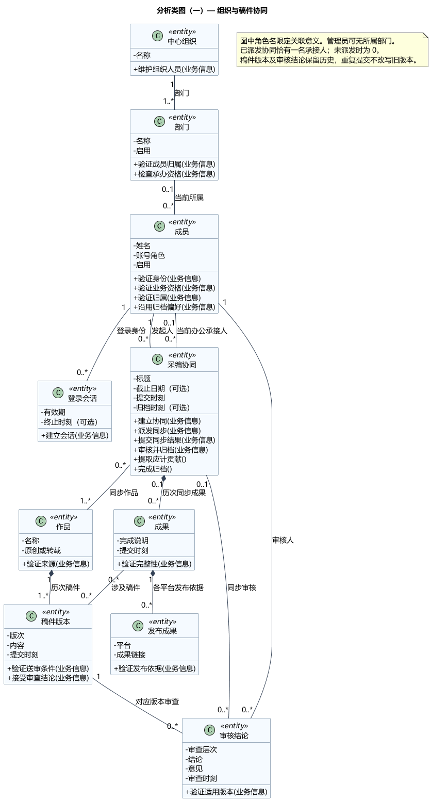

[PlantUML 图源](diagrams/analysis/class-editorial.puml) · [SVG 矢量图](diagrams/analysis/class-editorial.svg)

成员与部门表达组织关系，采编协同关联发起人、当前办公承接人和作品。作品保留稿件版本，审查结论绑定对应版本与审核人；发布成果保留平台和链接。登录会话关联有效成员，承载登录结果。

#### 5.2.2 摄制预约

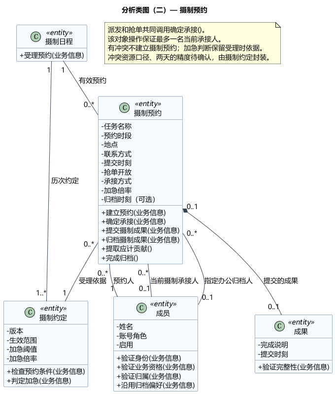

[PlantUML 图源](diagrams/analysis/class-production.puml) · [SVG 矢量图](diagrams/analysis/class-production.svg)

摄制日程负责预约受理，摄制约定封装冲突与加急判断。预约分别关联预约人、摄制承接人和办公归档人，避免把三种职责压成一个“负责人”。确定承接操作由派发与抢单共用。

#### 5.2.3 部门与跨部门流转

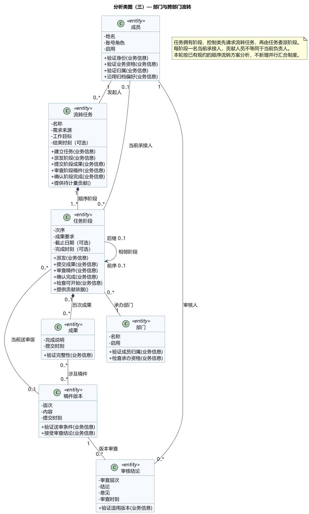

[PlantUML 图源](diagrams/analysis/class-workflow.puml) · [SVG 矢量图](diagrams/analysis/class-workflow.svg)

流转任务拥有有序阶段，阶段分别关联承办部门、当前承接成员及历次成果。调用阶段责任时先经过任务整体；相邻阶段关系用于验证流转条件，不用控制类拼接部门处理顺序。

#### 5.2.4 工作贡献与津贴核算

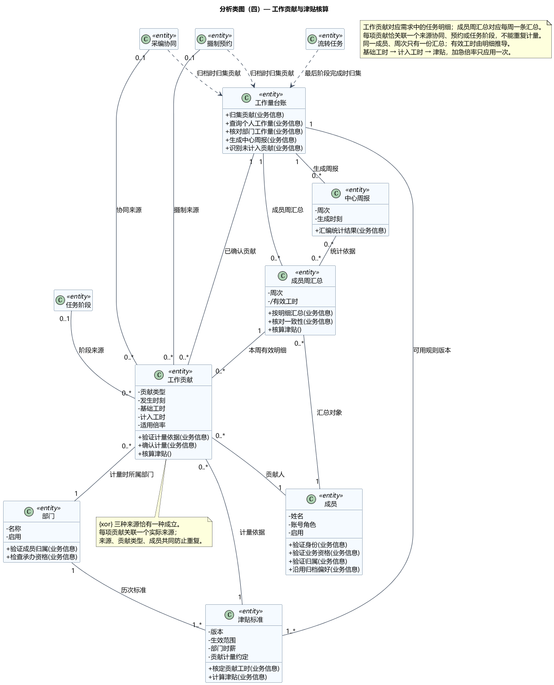

[PlantUML 图源](diagrams/analysis/class-accounting.puml) · [SVG 矢量图](diagrams/analysis/class-accounting.svg)

工作贡献对应需求中的任务明细，每项贡献保留实际来源、贡献人、计量部门和生效标准；同一成员、周次仅有一份周汇总。周汇总委托贡献核算津贴，周报汇编结果，导出不再计量。

#### 5.2.5 归档摄制成果的边界、控制与实体职责

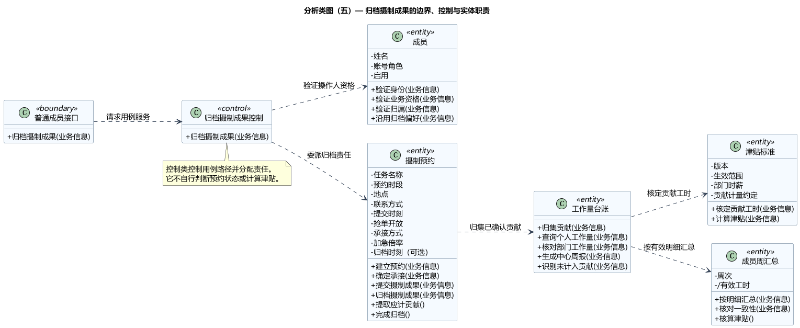

[PlantUML 图源](diagrams/analysis/class-responsibilities.puml) · [SVG 矢量图](diagrams/analysis/class-responsibilities.svg)

以 UC-PR-004 展示完整的边界—控制—实体协作。普通成员接口接收归档请求，控制对象委派责任，摄制预约验证归档资格和自身条件，台账与津贴标准完成贡献归集。

#### 5.2.6 采编协同用例职责

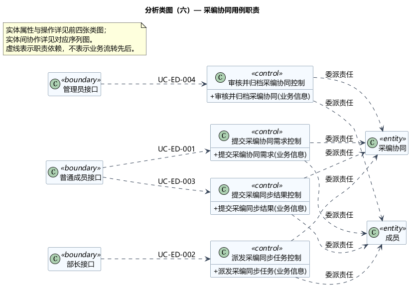

[PlantUML 图源](diagrams/analysis/class-controls-editorial.puml) · [SVG 矢量图](diagrams/analysis/class-controls-editorial.svg)

四个采编协同用例分别拥有同名控制类。普通成员接口承担需求提交与结果提交，部长接口承担派发，管理员接口承担老师审核请求；采编协同封装生命周期约束。

#### 5.2.7 摄制预约用例职责

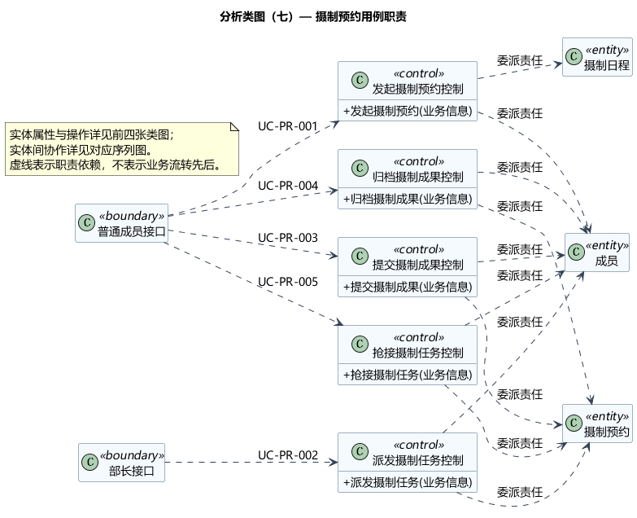

[PlantUML 图源](diagrams/analysis/class-controls-production.puml) · [SVG 矢量图](diagrams/analysis/class-controls-production.svg)

五个摄制用例分别由边界类转交其控制类。受理预约先交摄制日程，派发与抢单共用预约的确定承接责任；控制类不直接计算加急或改写负责人。

#### 5.2.8 部门流转与稿件审核用例职责

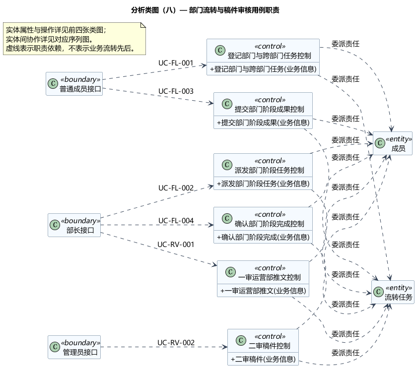

[PlantUML 图源](diagrams/analysis/class-controls-workflow.puml) · [SVG 矢量图](diagrams/analysis/class-controls-workflow.svg)

流转与稿件审核的六个控制类均先请求流转任务整体，再由整体委托阶段和稿件版本，避免外部控制类绕过任务整体改变内部阶段。

#### 5.2.9 登录、统计与组织用例职责

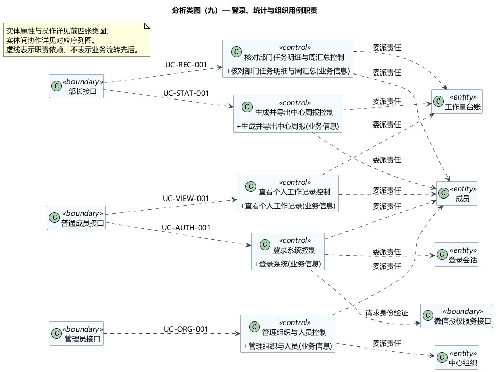

[PlantUML 图源](diagrams/analysis/class-controls-support.puml) · [SVG 矢量图](diagrams/analysis/class-controls-support.svg)

登录、个人查询、部门核对、中心周报与组织维护各有控制类。微信授权服务有独立边界；周报生成归办公部部长的部长接口，技术维护管理员不因此获得老师审稿职责。

同一成果只属于一种业务上下文：采编协同、摄制预约或任务阶段，三者满足互斥归属约束；三个视图中的 `0..1` 表示某一种可选归属，合起来恰有一个整体。稿件审核结论不必属于采编协同，通用流转稿件也可拥有相应审查结论。

跨视图协作中，采编协同、摄制预约和流转任务都可以委托工作量台账归集贡献。工作量台账是工作贡献的业务集合及其核对责任，不预设为某张数据库表。津贴标准和摄制约定代表已存在的会议规则及版本，不以其名称推定具体软件架构。

### 5.3 分析序列图

每个用例对应一张基本路径图，简单的退回、冲突或重复请求分支用 `alt`、`opt`、`break` 合并表达。图中成员等上下文对象由本次请求关联，未标创建消息的实体生命线表示本次责任协作对象，不能据此理解为修改前必须已经有持久化结果。涉及创建的关键例子在摄制预约图中特别画出，确保冲突分支不建立预约。

边界对象处理输入输出，控制对象仅组织路径。权限资格由成员及所属部门验证，任务的当前承接、成果和审查条件由相应实体自身验证；控制对象不通过读取一组属性来代替实体执行规则。所有异常返回均不得留下不符合后置条件的有效贡献或责任关系。

#### 5.3.1 UC-AUTH-001：登录系统

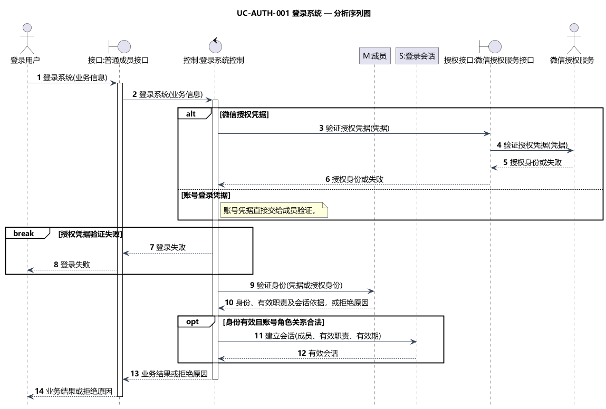

[PlantUML 图源](diagrams/analysis/seq-uc-auth-001.puml) · [SVG 矢量图](diagrams/analysis/seq-uc-auth-001.svg)

微信授权边界封装外部身份服务，成员承担账号有效性与角色关系验证；图中的登录入口为三类角色共用。

#### 5.3.2 UC-ED-001：提交采编协同需求

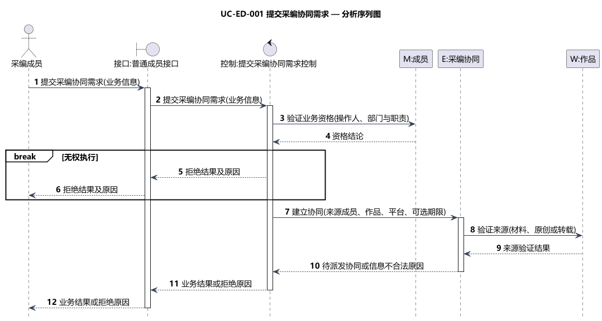

[PlantUML 图源](diagrams/analysis/seq-uc-ed-001.puml) · [SVG 矢量图](diagrams/analysis/seq-uc-ed-001.svg)

协同负责建立可追踪的需求，作品验证稿件来源；截止日期为空不作为拒绝理由。

#### 5.3.3 UC-ED-002：派发采编同步任务

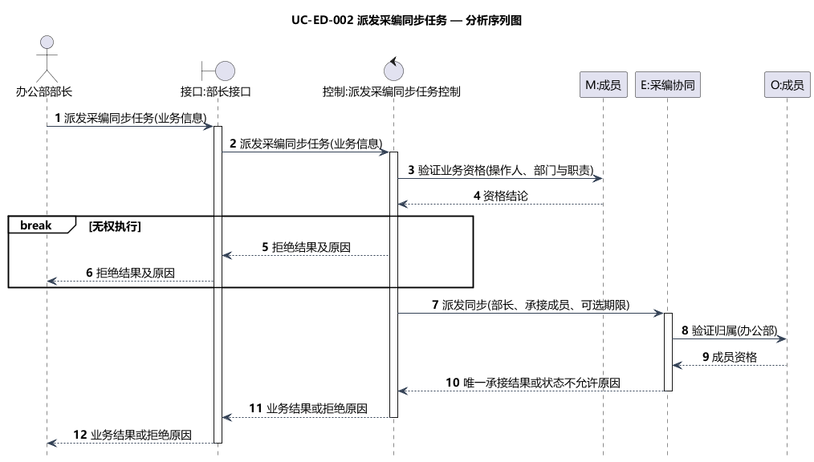

[PlantUML 图源](diagrams/analysis/seq-uc-ed-002.puml) · [SVG 矢量图](diagrams/analysis/seq-uc-ed-002.svg)

派发资格由成员和协同各自验证；协同保证待派发条件及唯一承接责任。

#### 5.3.4 UC-ED-003：提交采编同步结果

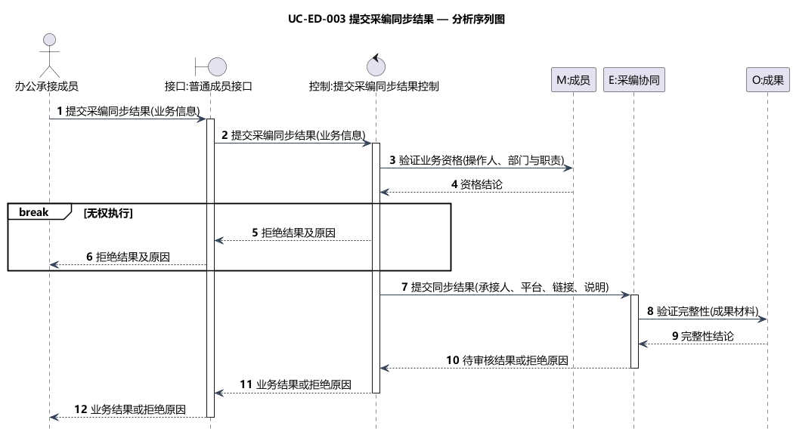

[PlantUML 图源](diagrams/analysis/seq-uc-ed-003.puml) · [SVG 矢量图](diagrams/analysis/seq-uc-ed-003.svg)

协同接收当前承接人的成果，并保留退回重提历史；成果对象验证完整性，控制类不逐项读取属性判断。

#### 5.3.5 UC-ED-004：审核并归档采编协同

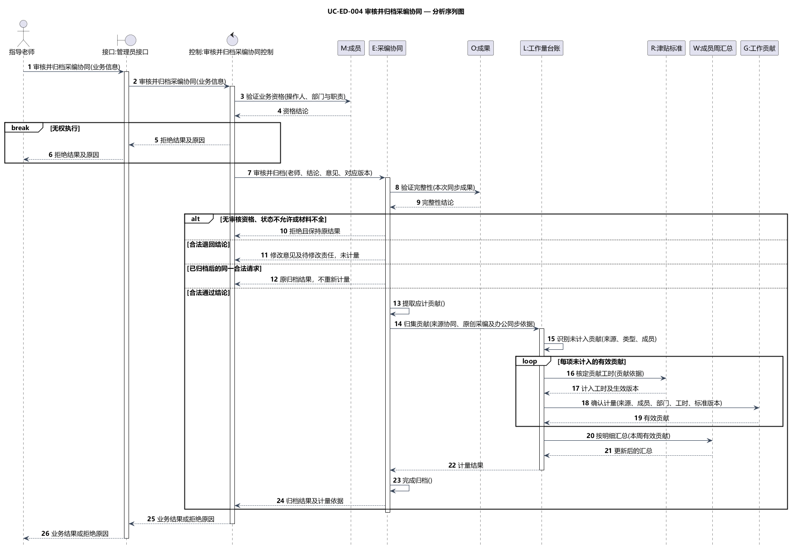

[PlantUML 图源](diagrams/analysis/seq-uc-ed-004.puml) · [SVG 矢量图](diagrams/analysis/seq-uc-ed-004.svg)

通过时分别归集原创采编和办公同步贡献；转载不产生原创写作贡献。退回不计量，重复合法归档返回原结果。归档与明细归集作为一致的业务结果完成；失败不留下半份有效结果。

#### 5.3.6 UC-PR-001：发起摄制预约

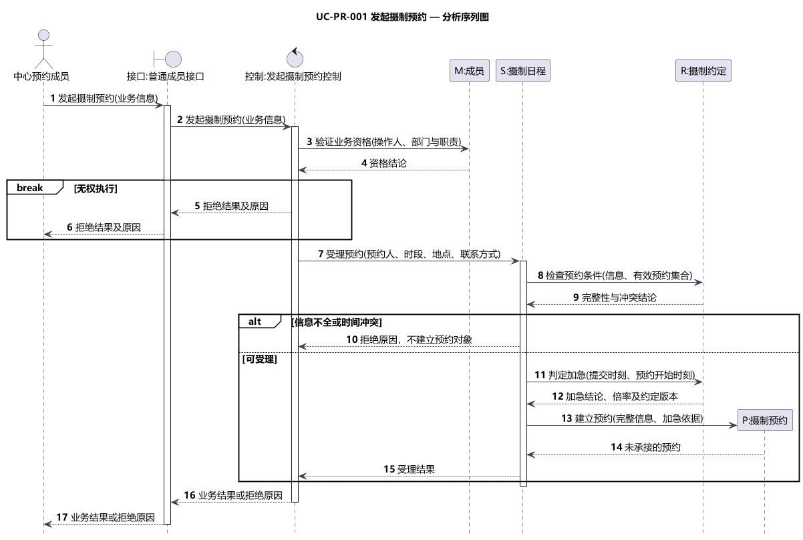

[PlantUML 图源](diagrams/analysis/seq-uc-pr-001.puml) · [SVG 矢量图](diagrams/analysis/seq-uc-pr-001.svg)

摄制日程负责受理并委托摄制约定判断冲突和加急；冲突分支没有预约对象。两天与 1.5 倍率作为约定依据保留，未明确的冲突资源范围不在分析中擅自定死。

#### 5.3.7 UC-PR-002：派发摄制任务

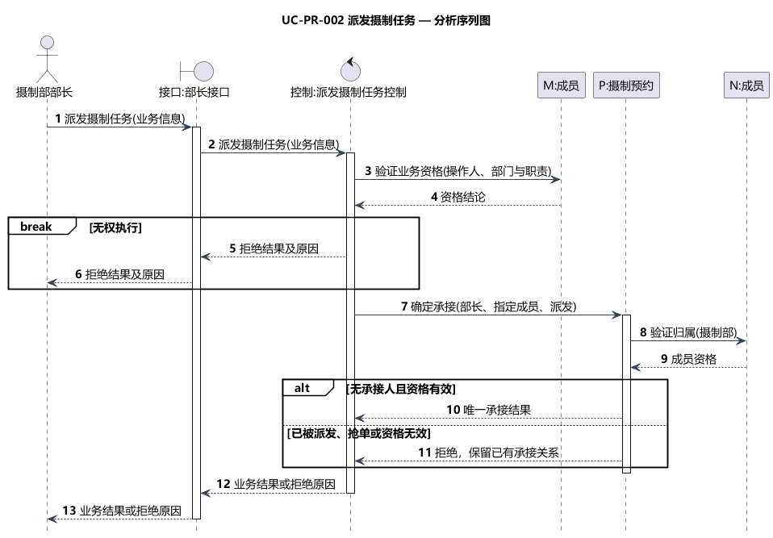

[PlantUML 图源](diagrams/analysis/seq-uc-pr-002.puml) · [SVG 矢量图](diagrams/analysis/seq-uc-pr-002.svg)

派发与抢单都请求摄制预约的确定承接操作，由同一对象保护唯一承接关系。

#### 5.3.8 UC-PR-003：提交摄制成果

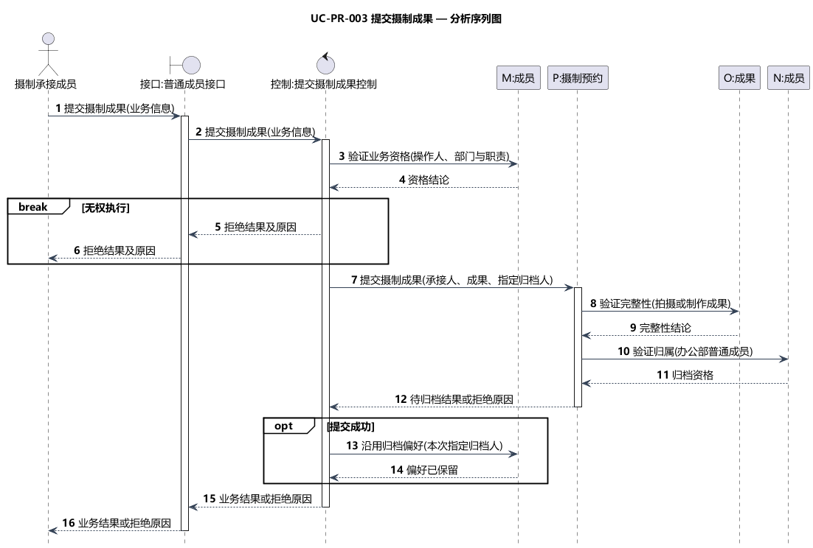

[PlantUML 图源](diagrams/analysis/seq-uc-pr-003.puml) · [SVG 矢量图](diagrams/analysis/seq-uc-pr-003.svg)

预约核验当前承接人，成果与办公成员分别承担完整性及归属验证；沿用归档偏好不能替代本次责任确认。

#### 5.3.9 UC-PR-004：归档摄制成果

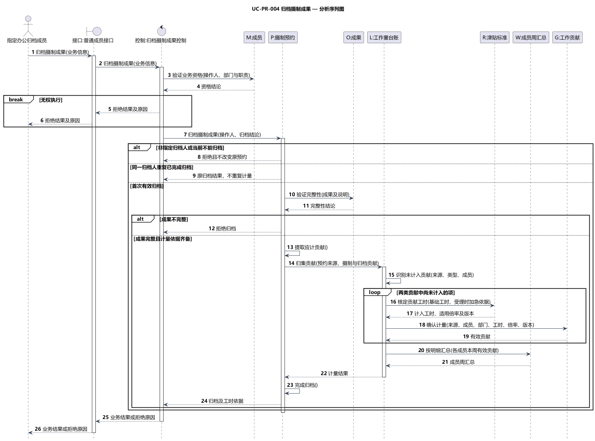

[PlantUML 图源](diagrams/analysis/seq-uc-pr-004.puml) · [SVG 矢量图](diagrams/analysis/seq-uc-pr-004.svg)

指定办公成员归档后形成摄制、归档两项贡献。加急是否适用于某类贡献由生效标准决定，不能直接把两类工时都乘 1.5；重复请求不再增加工时。

#### 5.3.10 UC-PR-005：抢接摄制任务

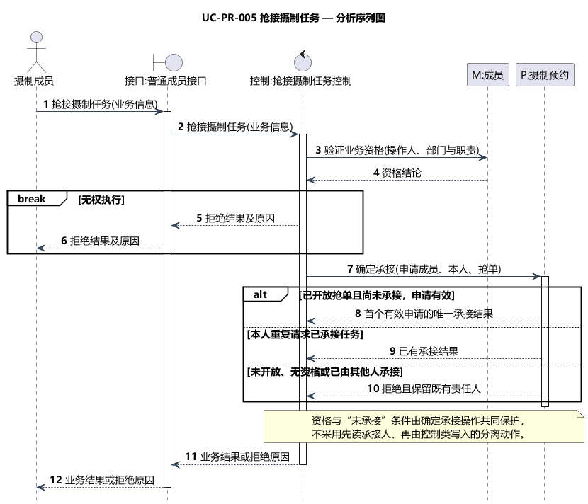

[PlantUML 图源](diagrams/analysis/seq-uc-pr-005.puml) · [SVG 矢量图](diagrams/analysis/seq-uc-pr-005.svg)

抢单与派发冲突时只有一个当前承接结果；抢单成功本身不计工时。

#### 5.3.11 UC-FL-001：登记部门与跨部门任务

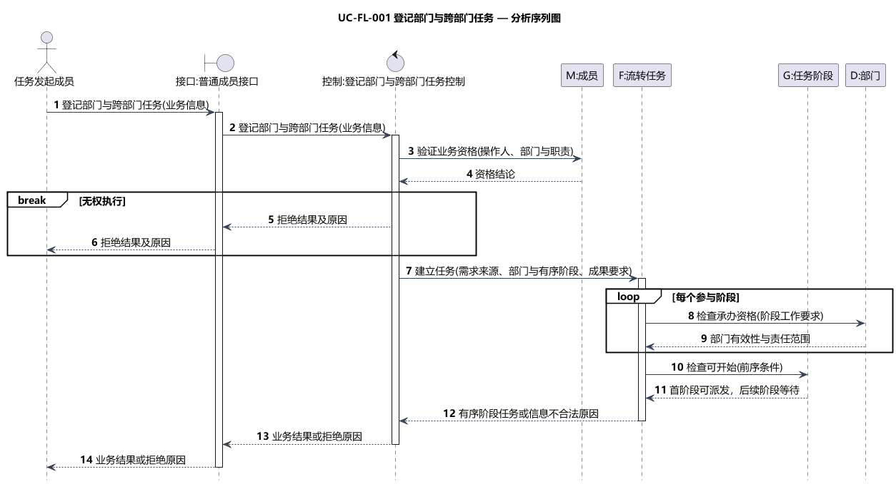

[PlantUML 图源](diagrams/analysis/seq-uc-fl-001.puml) · [SVG 矢量图](diagrams/analysis/seq-uc-fl-001.svg)

发起人登记的部门和阶段由任务整体组织；需求来源可以是外部门，登记人仍按当前规约描述为中心成员。

#### 5.3.12 UC-FL-002：派发部门阶段任务

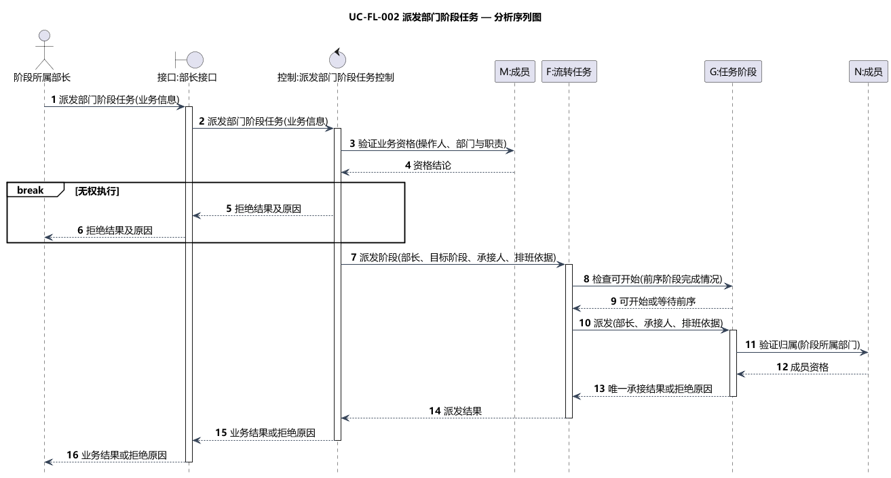

[PlantUML 图源](diagrams/analysis/seq-uc-fl-002.puml) · [SVG 矢量图](diagrams/analysis/seq-uc-fl-002.svg)

控制类先请求流转任务整体，再由任务委托阶段。前序未完成时阶段拒绝派发，排班仅作为部长安排依据。

#### 5.3.13 UC-FL-003：提交部门阶段成果

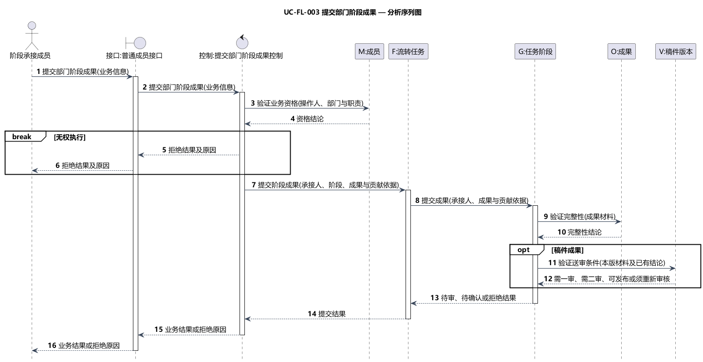

[PlantUML 图源](diagrams/analysis/seq-uc-fl-003.puml) · [SVG 矢量图](diagrams/analysis/seq-uc-fl-003.svg)

阶段根据成果性质决定后续责任。稿件内容变更需重新审查；已审稿件仅补充发布链接时进入完成确认，不把链接补充误当新一版稿件。

#### 5.3.14 UC-FL-004：确认部门阶段完成

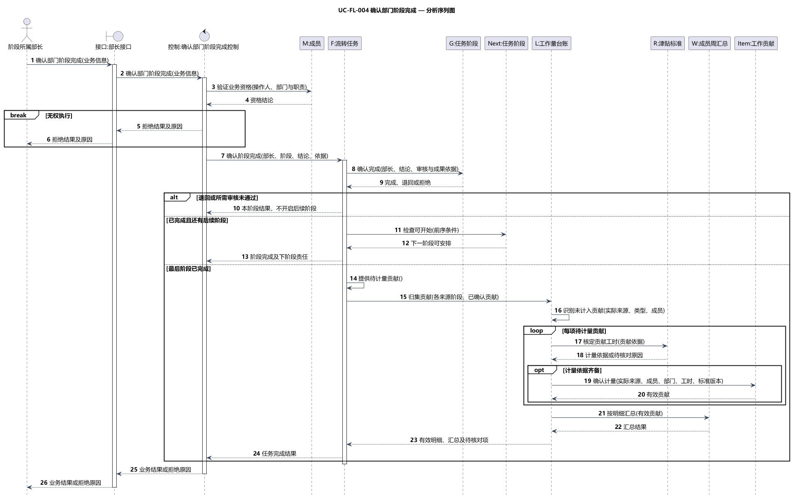

[PlantUML 图源](diagrams/analysis/seq-uc-fl-004.puml) · [SVG 矢量图](diagrams/analysis/seq-uc-fl-004.svg)

完成确认先由阶段验证稿件审核与成果条件。任务最后一阶段完成后归集贡献，依据不足的项标为待核对；专门流程已计入的相同实际贡献不能重复计量。

#### 5.3.15 UC-RV-001：一审运营部推文

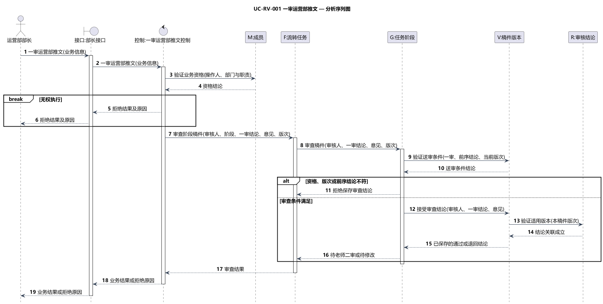

[PlantUML 图源](diagrams/analysis/seq-uc-rv-001.puml) · [SVG 矢量图](diagrams/analysis/seq-uc-rv-001.svg)

运营部长一审通过后转老师二审；稿件版本持有该版审查依据，不能以旧版本通过结论处理修改后的稿件。采编专门流程由 UC-ED-004 处理。

#### 5.3.16 UC-RV-002：二审稿件

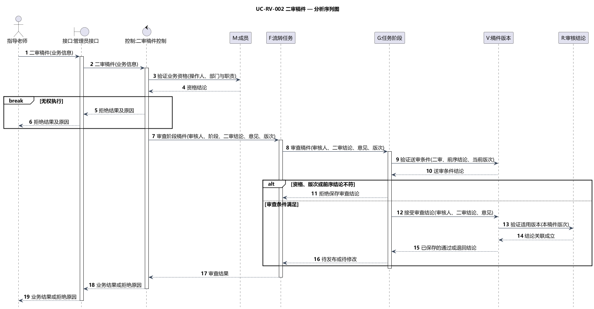

[PlantUML 图源](diagrams/analysis/seq-uc-rv-002.puml) · [SVG 矢量图](diagrams/analysis/seq-uc-rv-002.svg)

老师二审检查适用的前序结论；稿件版本持有该版审查依据，不能以旧版本通过结论处理修改后的稿件。采编专门流程由 UC-ED-004 处理。

#### 5.3.17 UC-REC-001：核对部门任务明细与周汇总

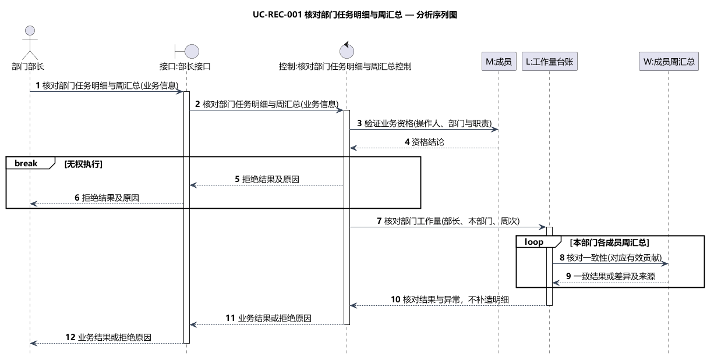

[PlantUML 图源](diagrams/analysis/seq-uc-rec-001.puml) · [SVG 矢量图](diagrams/analysis/seq-uc-rec-001.svg)

核对只比较有效明细及周汇总并标明差异，不能在查询期间悄悄补造贡献。

#### 5.3.18 UC-STAT-001：生成并导出中心周报

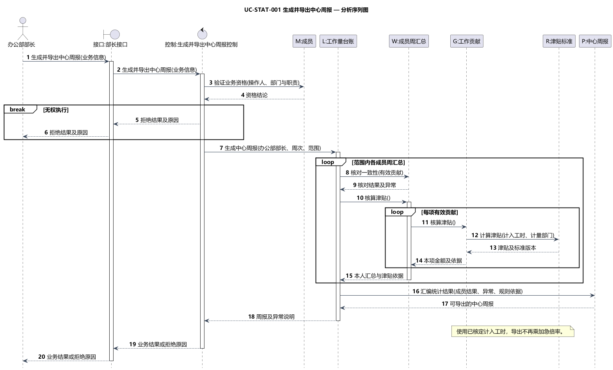

[PlantUML 图源](diagrams/analysis/seq-uc-stat-001.puml) · [SVG 矢量图](diagrams/analysis/seq-uc-stat-001.svg)

台账组织汇总，成员周汇总委托各项贡献核算，贡献按关联标准计算津贴。控制类不自行计算工时或时薪；周报生成不新增工作贡献。

#### 5.3.19 UC-ORG-001：管理组织与人员

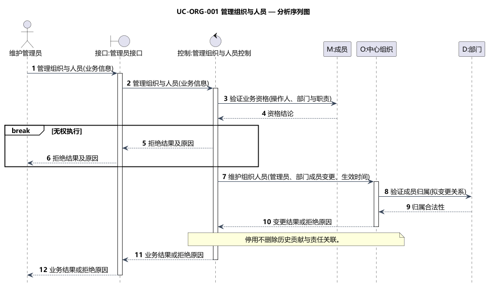

[PlantUML 图源](diagrams/analysis/seq-uc-org-001.puml) · [SVG 矢量图](diagrams/analysis/seq-uc-org-001.svg)

中心组织维护有效部门和成员关系；历史贡献保留计量时部门与规则依据，人员调整不改写既有统计。

#### 5.3.20 UC-VIEW-001：查看个人工作记录

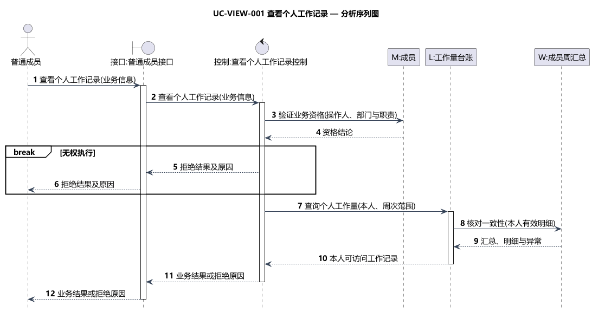

[PlantUML 图源](diagrams/analysis/seq-uc-view-001.puml) · [SVG 矢量图](diagrams/analysis/seq-uc-view-001.svg)

个人查询返回本人明细、周汇总及异常；系统内部的台账和汇总对象不是外部执行者。

上述图完整对应 20 个现有用例的主要责任协作。共用输入过滤和无效权限分支不重复细化为独立用例；具体扩展条件仍以对应规约为准。派发成功后的“交付任务”、成果提交后的“待审核责任”在本章表示责任结果，不额外承诺尚未确定的外部消息服务。

### 5.4 分析状态机图

为采编协同、摄制预约、任务阶段和流转任务建模；任务阶段分别展示运营推文与美编设计实例。初始节点表示对象建立后默认所处状态，不表示整个组织流程开始。已归档对象仍需支持查询及重复请求，因此保留为可响应对象，不以最终节点表示生命周期结束。

#### 5.4.1 采编协同

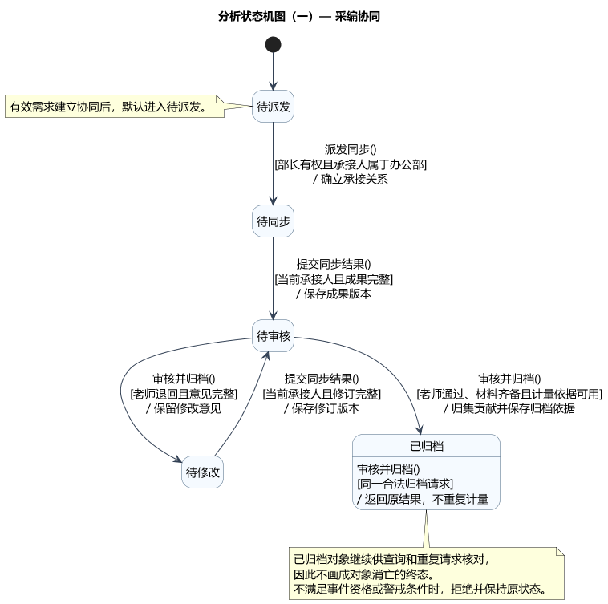

[PlantUML 图源](diagrams/analysis/state-editorial.puml) · [SVG 矢量图](diagrams/analysis/state-editorial.svg)

状态属于一条采编协同。迁移前核验审核、材料和可用计量依据，迁移动作完成贡献归集与归档；已归档仍可查询，重复合法归档用内部响应表示。

#### 5.4.2 摄制预约

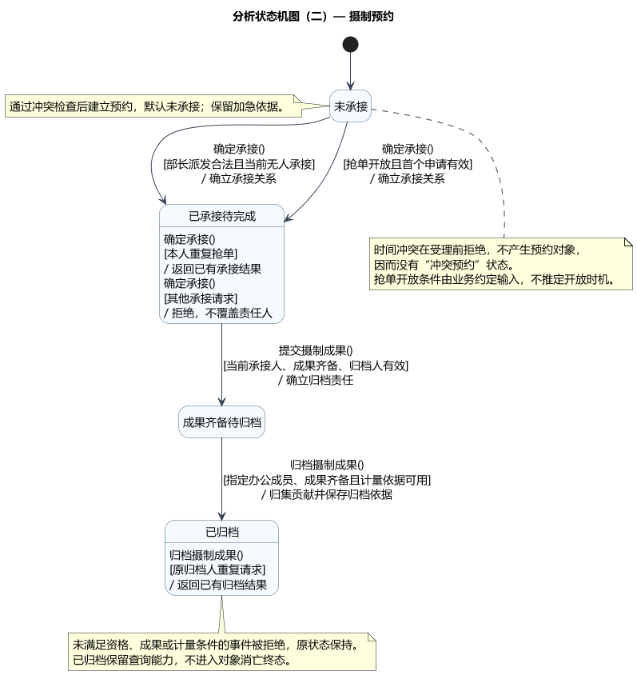

[PlantUML 图源](diagrams/analysis/state-production.puml) · [SVG 矢量图](diagrams/analysis/state-production.svg)

同一个确定承接事件按派发／抢单条件处理，未承接检查与建立承接关系作为一个对象责任。冲突拒绝发生在对象创建前。

#### 5.4.3 任务阶段

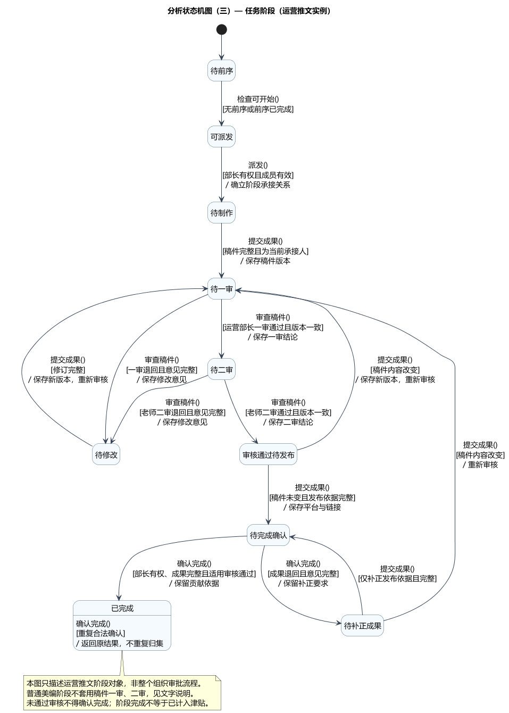

[PlantUML 图源](diagrams/analysis/state-stage.puml) · [SVG 矢量图](diagrams/analysis/state-stage.svg)

以已明确审核岗位的运营推文阶段为例。状态由承接、稿件版本、审核结论、发布依据共同决定；退回后分清稿件修改与发布依据补正。

#### 5.4.4 任务阶段

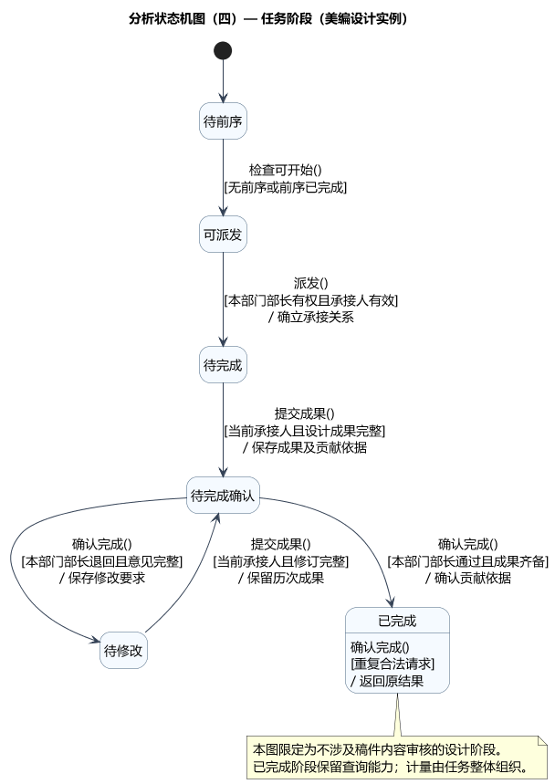

[PlantUML 图源](diagrams/analysis/state-stage-design.puml) · [SVG 矢量图](diagrams/analysis/state-stage-design.svg)

美编设计阶段直接交部长确认，不套用运营稿件的一审、二审；退回保留原责任人与历史成果。

#### 5.4.5 流转任务

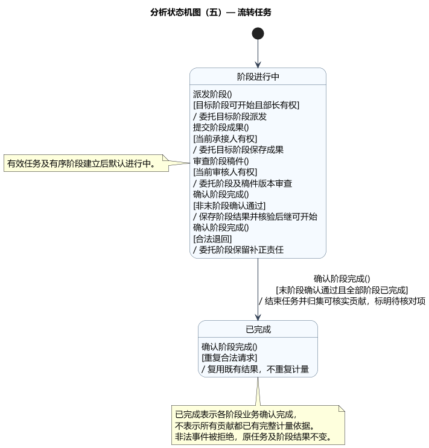

[PlantUML 图源](diagrams/analysis/state-workflow.puml) · [SVG 矢量图](diagrams/analysis/state-workflow.svg)

整体任务只在全部阶段完成后结束；规则或贡献依据缺失时保留待核对项，不把任务完成等同于津贴已核实。

运营推文实例不能直接套用于一审岗位尚未确定的其他部门；美编设计实例只适用于不涉及稿件内容审查的成果。阶段图描述局部责任，流转任务图描述整体完成条件。状态机图里的合法事件需要同时满足调用者资格与警戒条件；不满足时反馈拒绝并保留当前业务结果。

### 5.5 三类图的一致性

| 业务约束 | 承担责任的类与操作 | 序列图 | 状态约束 |
| --- | --- | --- | --- |
| 截止日期可选 | 采编协同.建立协同 | UC-ED-001 | 有效需求默认待派发 |
| 原创与同步贡献分别计量 | 采编协同.提取应计贡献；工作量台账.归集贡献 | UC-ED-004 | 通过且归集成功后已归档 |
| 冲突拒绝，不建立预约 | 摄制日程.受理预约；摄制约定.检查预约条件 | UC-PR-001 | 冲突不属于预约对象状态 |
| 派发和抢单唯一承接 | 摄制预约.确定承接 | UC-PR-002、005 | 未承接才接受首次承接 |
| 指定办公成员归档 | 摄制预约.归档摄制成果 | UC-PR-004 | 成果齐备待归档 → 已归档 |
| 修改稿件重新审核 | 任务阶段.提交成果；稿件版本.接受审查结论 | UC-FL-003、UC-RV-001／002 | 待修改／内容变更 → 待一审 |
| 前序完成才流转 | 流转任务.确认阶段完成；任务阶段.检查可开始 | UC-FL-004 | 待前序 → 可派发 |
| 一个成员每周一份汇总 | 工作量台账.归集贡献；成员周汇总.按明细汇总 | UC-ED-004、UC-PR-004、UC-FL-004 | 归档／完成确认后才提供有效计量依据 |
| 导出不重复加急计量 | 工作贡献.核算津贴；津贴标准.计算津贴 | UC-STAT-001 | 导出不改变任务完成状态 |

分析模型中的“归集成功”表示所需业务结果一致成立，不预设数据库事务、锁或接口实现。任务阶段可以完成但某项贡献因规则缺失而待核对；这种情况按 UC-FL-004 输出异常，不能填零冒充已核实工时。分析阶段继续保持“拟开发方案”的性质，实际软件是否实现由后续设计、实现与验证确认。

## 6 数据库设计

### 6.1 课程依据与设计范围

本章依据课程课件第 398～403 页（PDF 物理页），将第 5 节分析类图中的持久化实体及其关联映射为关系数据库结构：类对应表，属性对应列，对象对应行；一对多关联在多端设置外键，组合关系的部分对象通过非空外键依附整体，多对多关联转换为中间表。先消除不合理依赖，再讨论性能优化。

本设计服务于青年传媒中心的采编协同、摄制预约、部门流转、稿件审查和津贴统计。分析阶段的边界类、控制类及对象操作由程序实现，不机械转换为数据表。分析中的派生属性由查询计算；一个分析实体包含多个不同粒度的事实时，拆成多张表。

本章为拟开发系统的关系模型。现有小程序使用微信云数据库集合；[参考 DDL](database/schema.sqlite.sql)采用 SQLite 在本地验证关系约束，未执行线上集合迁移。关系模型落地时再结合所选数据库调整类型与约束实现。

### 6.2 数据库关系总图

[放大查看 SVG 总图](diagrams/database/db-overview.svg) · [高清 PNG](diagrams/database/db-overview.png) · [PlantUML 图源](diagrams/database/db-overview.puml)

图 46 包含全部 47 张基表、5 个派生视图，按七个业务区域着色并采用三列布局。每区内部以表的实际高度紧凑排布，边缘保留小幅扩展带；同一张表只出现一次。全部外键的目标表在字段旁标明，表外只绘制 21 条关键关联，避免所有引用交叉成网。表头下的分析实体名称用于追溯原类图。关系线采用直线和正交折线，箭头从外键表指向目标表；绿色卡片是视图。

表卡片采用参考示范的字段列表形式，不展示类型、空值列或约束表达式。字段旁的黄色钥匙表示主键，独立的蓝色小箭头表示外键，蓝色箭头后直接显示目标表名；一个字段同时属于主键和外键时并列显示两个图标。

复合主键由多个字段的钥匙图标共同表示；复合外键的组成、目标列和完整约束见[外键关系清单](database/foreign-key-relations.md)及[数据字典](database/data-dictionary.md)。不同职责引用成员表时仍保留各自字段，避免含义不清的“负责人”。主图省略部分表外线只影响展示，不删除数据库外键。总图适合放大或大幅面展示。

### 6.3 分析类到关系模型的对应

下表与原四张领域分析类图及其职责视图中的 20 个实体逐项对应。辅助表细化已有属性、关联与历史事实，不增加业务用例。

| 原分析实体 | 对应基表／视图 | 映射说明 |
| --- | --- | --- |
| 中心组织 | organization | 保存中心标识与名称。 |
| 部门 | department | 多端保存 organization_id；部门名称在组织内唯一。 |
| 成员 | member、external_identity、archive_preference | 成员账号、外部登录身份、摄制成员的办公归档偏好分别保存；偏好不能代替实际任务归档责任。 |
| 登录会话 | login_session | 保存成员外键、令牌散列与有效时段。 |
| 采编协同 | editorial、editorial_work、editorial_target、editorial_assignment、editorial_archive | 协同主体、作品集合、目标平台、唯一办公承接责任和完成归档事实分开。 |
| 作品 | work、platform | 保存作品名称及原创／转载类型；平台从发布与投稿关联中的重复文字提取为字典。 |
| 稿件版本 | manuscript_version | 版本依附作品；版次在作品内唯一，修改稿件新增版本。 |
| 成果 | outcome、outcome_attachment、outcome_version | 每次成果提交独立编号；附件与稿件集合拆成子表／中间表。 |
| 发布成果 | publication | 每条发布事实保存平台与链接；稿件发布绑定本次成果实际包含的版本。 |
| 审核结论 | manuscript_review、editorial_review、editorial_review_item | 稿件版本审查与采编同步审核分别记录；关联表保存同步审核实际采信的稿件审查依据。 |
| 摄制日程 | production_schedule | 一部门对应一个日程入口，预约时段经预约引用的约定版本归入该日程。 |
| 摄制约定 | booking_terms | 保存不可改写的约定版本、加急阈值、倍率与生效起点。 |
| 摄制预约 | production_booking、production_assignment、production_archive_responsibility、production_archive | 预约、唯一摄制承接、任务级办公归档责任及归档事实分开。 |
| 流转任务 | workflow、workflow_completion | 保存整体任务与最终完成事实；business_source 是专门流程与通用阶段共享来源的设计辅助标识。 |
| 任务阶段 | task_stage、stage_assignment、stage_source、stage_current_draft、stage_confirmation、stage_completion、stage_contribution | 阶段次序、承接、来源、当前送审版、确认历史、最终完成依据及贡献引用分开。 |
| 工作量台账 | contribution_basis、contribution_measurement 及贡献查询视图 | 台账是贡献集合的归集／查询职责，不增设没有独立事实的空“台账表”。 |
| 工作贡献 | contribution_basis、contribution_measurement、contribution_type、v_contribution_detail、v_contribution_money | 实际贡献依据与已核实计量分开；有效工时和津贴通过规则版本计算。 |
| 成员周汇总 | v_member_weekly_summary | 按成员与工作周聚合，每成员每周至多一行，明细可追溯。 |
| 津贴标准 | allowance_standard、contribution_policy | 部门时薪版本与该版本下各贡献类型的计量规则分开。 |
| 中心周报 | weekly_report、report_department、report_contribution、report_pending、report_seal、v_report_member_summary | 保存批次、统计范围、当次有效明细及待核对集合；封存后根据固定集合计算历史结果。 |

分析类图中的关联进一步细化为外键关系。例如作品与稿件版本为一对多组合，manuscript_version.work_id 为非空外键；任务与阶段为一对多组合，task_stage.workflow_id 为非空外键。协同与作品、成果与稿件版本、阶段与贡献、周报与有效贡献均使用中间表表达多对多关系。

分析图没有要求成员、部长、管理员三者建立继承表，因此本设计使用 member.account_role 表达现有三种账号角色。contribution_measurement 与 contribution_basis 共用主键，表示“已有贡献依据可具有一份已核实计量”的零或一扩展，不据此为原类图补造继承关系。

### 6.4 关系约束与业务一致性

| 约束事项 | 数据库表达 | 业务事务的责任 |
| --- | --- | --- |
| 稳定标识 | 实体采用独立主键；登录名、组织内部门名、作品内版次等另设唯一约束；姓名不作主键。 | 核验用户提交内容与所属组织。 |
| 唯一承接 | 三类承接表分别以 editorial_id、booking_id、stage_id 为主键；一次业务至多一条有效承接责任。 | 派发／抢单检查待承接条件与成员资格，写入同一张承接表；竞争失败返回已有承接结果。 |
| 正确业务来源 | business_source 三种真实业务外键恰好一个非空；每个专门任务／阶段至多一个来源标识。 | 专门流程在通用阶段复用时复用同一 source_id，不能重新制造相同工作。 |
| 版本与审核对应 | 审核引用 version_id；运营双审的二审须引用同版通过的一审，其他稿件流程按已确认审查政策处理；成果版本采用复合主键；发布的组合外键引用成果所含版本。 | 核验一审／二审岗位资格与审查次序；修改稿件重新送审，不能沿用旧版通过结论。 |
| 采编归档 | 归档引用通过的同步审核；触发器核验本次提交稿件的审查依据。 | 核验协同作品、要求平台与实际发布是否完整；退回新增成果提交，保留历史。 |
| 摄制归档 | 归档绑定该预约成果和指定办公人员；归档主键防止重复完成。 | 指定人员必须具有办公归档资格；归档与应计贡献登记在同一事务提交。 |
| 阶段推进 | 阶段序号在任务内唯一；已有前序阶段完成后才允许派发后序；运营完成绑定实际采信的同版通过二审。 | 事务开始前核验阶段编排完整、责任部门、最新成果与状态机迁移条件。 |
| 贡献去重 | UNIQUE(source_id,type_id,member_id)；阶段仅引用贡献；已核实计量与贡献依据共用主键。 | 原创写作与办公同步使用不同类型，转载不生成原创写作贡献；多人或多阶段的不同真实工作使用相应独立来源与类型。 |
| 有效计量 | 无核实计量子行的贡献列入待核对；专门流程归档、通用任务整体结束后才允许形成有效计量。 | 验证计量证据及会议规则适用范围；待核对项不以零工时代替有效明细。 |
| 规则追溯 | 计量引用 policy_id，规则引用不可变 standard_id；加急倍率取预约受理时引用的约定。 | 根据已确定的生效口径选定规则版本；1.5 仅用于适用贡献，汇总不再次乘倍率。 |
| 周报一致性 | 周报固定部门范围与明细集合；封存前检查范围内有效及待核对贡献完整性；封存后禁止扩充或改写。 | 办公部部长在同一一致性快照／事务中生成、检查并封存；重新导出读取相同批次。 |
| 预约时间冲突 | 保存有效起止时间及日程引用，建立时段索引。 | 在明确冲突资源后锁定该资源／日程，检查 start_existing < end_new 且 end_existing > start_new；检查与插入在同一串行化事务完成。冲突则回滚，不创建预约。 |

外键保证“被引用记录存在”，不能单独证明角色权限、业务资格、所有平台发布齐全或状态迁移合法。跨表规则由约束／触发器与业务事务共同完成，不能仅做一次查询后无锁写入。课程状态机中的条件在迁移前检查；归档、完成事实与贡献登记一起提交，任一环节失败则整体回滚。

### 6.5 范式核对

本模型按当前已识别函数依赖设计到第三范式。以下核对针对基表；派生视图用于查询，不要求把计算值反写为新的基表。

| 范式 | 本设计的处理 | 可核对实例 |
| --- | --- | --- |
| 第一范式（1NF） | 每列保存该列语义下的单一值，多值关系拆行；不保存逗号分隔成员、平台、版本或附件 ID。 | editorial_target 每行是一个协同作品的一项平台要求；publication 每行一条发布链接；outcome_attachment 每行一个附件引用。 |
| 第二范式（2NF） | 复合键表的非键属性依赖完整候选键，不把只依赖一部分键的属性放入该表。 | editorial_work、editorial_target、outcome_version、stage_contribution 等仅保存完整关联键。report_pending 的 reason 表示“该批次对该贡献的待核对原因”，依赖 report_id＋basis_id。 |
| 第三范式（3NF） | 主表不复制经外键可查的名称、时薪、规则说明或可计算汇总；消除非键属性间的传递依赖。 | member 仅引用 department_id；contribution_measurement 仅引用 policy_id，不重复存 standard_id、部门时薪、倍率与津贴；成员周汇总由视图产生。 |

关键函数依赖为：organization_id → 中心名称；department_id → organization_id、部门名称；work_id → 作品名称、来源类型；version_id 与 (work_id,revision_no) 分别决定版本内容和提交事实；(source_id,type_id,member_id) → 贡献依据及历史归属；basis_id → policy_id、基础工时与核定时刻；policy_id 与 (standard_id,type_id) 分别决定计量规则；standard_id → 规则部门、版本、生效起点、时薪；(report_id,basis_id) → 当次待核对原因。复合候选键通过唯一约束表达。

贡献的 department_id 表示该次工作所属部门，是历史业务事实。它不能由成员**当前** department_id 推导，成员调动不会改写过去贡献的归属。周报明细集合与待核对原因同样是“生成当次”的事实；它们与实时台账查询的粒度不同，不属于为性能而复制总额。当前工时、周总额和津贴均不作为可编辑字段重复保存。

### 6.6 类型、精度与历史保存

标识在参考稿中使用 64 位整数，部署时可选 BIGINT 或 UUID。角色、来源类型、审核结果等由受约束代码表示；规则说明和业务联系信息为文本。稿件内容为该版本的完整文本，附件内容存对象存储，表内保存存储引用。

参考稿时间统一为 Asia/Shanghai 的 `YYYY-MM-DD HH:MM:SS`，周次为日期；正式 RDBMS 使用合适的 DATE／TIMESTAMP 类型。预约采用半开区间 [开始,结束)，相邻时段端点相等不构成重叠；这不替代会议对实际冲突资源范围的确定。

基础工时以万分之一小时整数保存，倍率以万分位整数保存，津贴以分保存。1.5 倍保存为 15000；有效工时 = 基础工时 × 适用倍率，津贴 = 有效工时 × 版本时薪。参考计算逐贡献按四舍五入得到固定精度工时和分金额，周报汇总明细金额；这些精度与周边界是本设计的计算约定，试行前应与实际统计制度核对。

稿件提交、审查结论、完成归档、已核实计量和会议规则版本保留历史，不覆盖旧记录。部门或成员退出使用停用标记，外键采用删除限制，不能级联清除历史工作记录。当前送审指针等可变事实与历史记录分开；周报封存后的再次下载不新增工作贡献。

### 6.7 设计验证

[本地验证记录](database/verification.txt)覆盖键与引用完整性、派发／抢单唯一承接、审核版次绑定、重复计量拒绝、归档完成门槛、倍率只应用一次、规则历史保留、周报完整性与封存后稳定性。验证使用独立内存数据库。图源、渲染结果、全部外键与分析实体对应关系也进行一致性检查。

这些检查用于验证本章关系设计及参考 SQL 的具体约束；现有云数据库、真实用户权限和并发业务流程需要在实现阶段分别验证。
