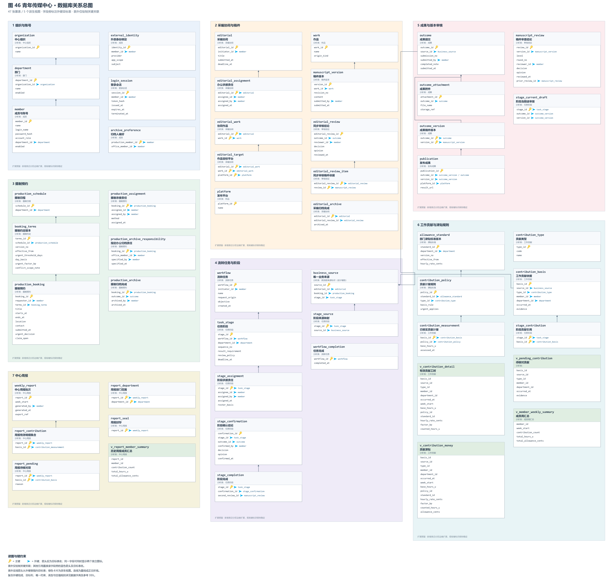

# 6 数据库设计

## 6.1 课程依据与设计范围

本章依据课程课件第 398～403 页（PDF 物理页），将第 5 节分析类图中的持久化实体及其关联映射为关系数据库结构：类对应表，属性对应列，对象对应行；一对多关联在多端设置外键，组合关系的部分对象通过非空外键依附整体，多对多关联转换为中间表。先消除不合理依赖，再讨论性能优化。

本设计服务于青年传媒中心的采编协同、摄制预约、部门流转、稿件审查和津贴统计。分析阶段的边界类、控制类及对象操作由程序实现，不机械转换为数据表。分析中的派生属性由查询计算；一个分析实体包含多个不同粒度的事实时，拆成多张表。

本章为拟开发系统的关系模型。现有小程序使用微信云数据库集合；[参考 DDL](../database/schema.sqlite.sql)采用 SQLite 在本地验证关系约束，未执行线上集合迁移。关系模型落地时再结合所选数据库调整类型与约束实现。

## 6.2 数据库关系总图

[放大查看 SVG 总图](../diagrams/database/db-overview.svg) · [高清 PNG](../diagrams/database/db-overview.png) · [PlantUML 图源](../diagrams/database/db-overview.puml)

图 46 包含全部 47 张基表、5 个派生视图，按七个业务区域着色并采用三列布局。每区内部以表的实际高度紧凑排布，边缘保留小幅扩展带；同一张表只出现一次。全部外键的目标表在字段旁标明，表外只绘制 21 条关键关联，避免所有引用交叉成网。表头下的分析实体名称用于追溯原类图。关系线采用直线和正交折线，箭头从外键表指向目标表；绿色卡片是视图。

表卡片采用参考示范的字段列表形式，不展示类型、空值列或约束表达式。字段旁的黄色钥匙表示主键，独立的蓝色小箭头表示外键，蓝色箭头后直接显示目标表名；一个字段同时属于主键和外键时并列显示两个图标。

复合主键由多个字段的钥匙图标共同表示；复合外键的组成、目标列和完整约束见[外键关系清单](../database/foreign-key-relations.md)及[数据字典](../database/data-dictionary.md)。不同职责引用成员表时仍保留各自字段，避免含义不清的“负责人”。主图省略部分表外线只影响展示，不删除数据库外键。总图适合放大或大幅面展示。

## 6.3 分析类到关系模型的对应

下表与原四张领域分析类图及其职责视图中的 20 个实体逐项对应。辅助表细化已有属性、关联与历史事实，不增加业务用例。

| 原分析实体 | 对应基表／视图 | 映射说明 |
| --- | --- | --- |
| 中心组织 | organization | 保存中心标识与名称。 |
| 部门 | department | 多端保存 organization_id；部门名称在组织内唯一。 |
| 成员 | member、external_identity、archive_preference | 成员账号、外部登录身份、摄制成员的办公归档偏好分别保存；偏好不能代替实际任务归档责任。 |
| 登录会话 | login_session | 保存成员外键、令牌散列与有效时段。 |
| 采编协同 | editorial、editorial_work、editorial_target、editorial_assignment、editorial_archive | 协同主体、作品集合、目标平台、唯一办公承接责任和完成归档事实分开。 |
| 作品 | work、platform | 保存作品名称及原创／转载类型；平台从发布与投稿关联中的重复文字提取为字典。 |
| 稿件版本 | manuscript_version | 版本依附作品；版次在作品内唯一，修改稿件新增版本。 |
| 成果 | outcome、outcome_attachment、outcome_version | 每次成果提交独立编号；附件与稿件集合拆成子表／中间表。 |
| 发布成果 | publication | 每条发布事实保存平台与链接；稿件发布绑定本次成果实际包含的版本。 |
| 审核结论 | manuscript_review、editorial_review、editorial_review_item | 稿件版本审查与采编同步审核分别记录；关联表保存同步审核实际采信的稿件审查依据。 |
| 摄制日程 | production_schedule | 一部门对应一个日程入口，预约时段经预约引用的约定版本归入该日程。 |
| 摄制约定 | booking_terms | 保存不可改写的约定版本、加急阈值、倍率与生效起点。 |
| 摄制预约 | production_booking、production_assignment、production_archive_responsibility、production_archive | 预约、唯一摄制承接、任务级办公归档责任及归档事实分开。 |
| 流转任务 | workflow、workflow_completion | 保存整体任务与最终完成事实；business_source 是专门流程与通用阶段共享来源的设计辅助标识。 |
| 任务阶段 | task_stage、stage_assignment、stage_source、stage_current_draft、stage_confirmation、stage_completion、stage_contribution | 阶段次序、承接、来源、当前送审版、确认历史、最终完成依据及贡献引用分开。 |
| 工作量台账 | contribution_basis、contribution_measurement 及贡献查询视图 | 台账是贡献集合的归集／查询职责，不增设没有独立事实的空“台账表”。 |
| 工作贡献 | contribution_basis、contribution_measurement、contribution_type、v_contribution_detail、v_contribution_money | 实际贡献依据与已核实计量分开；有效工时和津贴通过规则版本计算。 |
| 成员周汇总 | v_member_weekly_summary | 按成员与工作周聚合，每成员每周至多一行，明细可追溯。 |
| 津贴标准 | allowance_standard、contribution_policy | 部门时薪版本与该版本下各贡献类型的计量规则分开。 |
| 中心周报 | weekly_report、report_department、report_contribution、report_pending、report_seal、v_report_member_summary | 保存批次、统计范围、当次有效明细及待核对集合；封存后根据固定集合计算历史结果。 |

分析类图中的关联进一步细化为外键关系。例如作品与稿件版本为一对多组合，manuscript_version.work_id 为非空外键；任务与阶段为一对多组合，task_stage.workflow_id 为非空外键。协同与作品、成果与稿件版本、阶段与贡献、周报与有效贡献均使用中间表表达多对多关系。

分析图没有要求成员、部长、管理员三者建立继承表，因此本设计使用 member.account_role 表达现有三种账号角色。contribution_measurement 与 contribution_basis 共用主键，表示“已有贡献依据可具有一份已核实计量”的零或一扩展，不据此为原类图补造继承关系。

## 6.4 关系约束与业务一致性

| 约束事项 | 数据库表达 | 业务事务的责任 |
| --- | --- | --- |
| 稳定标识 | 实体采用独立主键；登录名、组织内部门名、作品内版次等另设唯一约束；姓名不作主键。 | 核验用户提交内容与所属组织。 |
| 唯一承接 | 三类承接表分别以 editorial_id、booking_id、stage_id 为主键；一次业务至多一条有效承接责任。 | 派发／抢单检查待承接条件与成员资格，写入同一张承接表；竞争失败返回已有承接结果。 |
| 正确业务来源 | business_source 三种真实业务外键恰好一个非空；每个专门任务／阶段至多一个来源标识。 | 专门流程在通用阶段复用时复用同一 source_id，不能重新制造相同工作。 |
| 版本与审核对应 | 审核引用 version_id；运营双审的二审须引用同版通过的一审，其他稿件流程按已确认审查政策处理；成果版本采用复合主键；发布的组合外键引用成果所含版本。 | 核验一审／二审岗位资格与审查次序；修改稿件重新送审，不能沿用旧版通过结论。 |
| 采编归档 | 归档引用通过的同步审核；触发器核验本次提交稿件的审查依据。 | 核验协同作品、要求平台与实际发布是否完整；退回新增成果提交，保留历史。 |
| 摄制归档 | 归档绑定该预约成果和指定办公人员；归档主键防止重复完成。 | 指定人员必须具有办公归档资格；归档与应计贡献登记在同一事务提交。 |
| 阶段推进 | 阶段序号在任务内唯一；已有前序阶段完成后才允许派发后序；运营完成绑定实际采信的同版通过二审。 | 事务开始前核验阶段编排完整、责任部门、最新成果与状态机迁移条件。 |
| 贡献去重 | UNIQUE(source_id,type_id,member_id)；阶段仅引用贡献；已核实计量与贡献依据共用主键。 | 原创写作与办公同步使用不同类型，转载不生成原创写作贡献；多人或多阶段的不同真实工作使用相应独立来源与类型。 |
| 有效计量 | 无核实计量子行的贡献列入待核对；专门流程归档、通用任务整体结束后才允许形成有效计量。 | 验证计量证据及会议规则适用范围；待核对项不以零工时代替有效明细。 |
| 规则追溯 | 计量引用 policy_id，规则引用不可变 standard_id；加急倍率取预约受理时引用的约定。 | 根据已确定的生效口径选定规则版本；1.5 仅用于适用贡献，汇总不再次乘倍率。 |
| 周报一致性 | 周报固定部门范围与明细集合；封存前检查范围内有效及待核对贡献完整性；封存后禁止扩充或改写。 | 办公部部长在同一一致性快照／事务中生成、检查并封存；重新导出读取相同批次。 |
| 预约时间冲突 | 保存有效起止时间及日程引用，建立时段索引。 | 在明确冲突资源后锁定该资源／日程，检查 start_existing < end_new 且 end_existing > start_new；检查与插入在同一串行化事务完成。冲突则回滚，不创建预约。 |

外键保证“被引用记录存在”，不能单独证明角色权限、业务资格、所有平台发布齐全或状态迁移合法。跨表规则由约束／触发器与业务事务共同完成，不能仅做一次查询后无锁写入。课程状态机中的条件在迁移前检查；归档、完成事实与贡献登记一起提交，任一环节失败则整体回滚。

## 6.5 范式核对

本模型按当前已识别函数依赖设计到第三范式。以下核对针对基表；派生视图用于查询，不要求把计算值反写为新的基表。

| 范式 | 本设计的处理 | 可核对实例 |
| --- | --- | --- |
| 第一范式（1NF） | 每列保存该列语义下的单一值，多值关系拆行；不保存逗号分隔成员、平台、版本或附件 ID。 | editorial_target 每行是一个协同作品的一项平台要求；publication 每行一条发布链接；outcome_attachment 每行一个附件引用。 |
| 第二范式（2NF） | 复合键表的非键属性依赖完整候选键，不把只依赖一部分键的属性放入该表。 | editorial_work、editorial_target、outcome_version、stage_contribution 等仅保存完整关联键。report_pending 的 reason 表示“该批次对该贡献的待核对原因”，依赖 report_id＋basis_id。 |
| 第三范式（3NF） | 主表不复制经外键可查的名称、时薪、规则说明或可计算汇总；消除非键属性间的传递依赖。 | member 仅引用 department_id；contribution_measurement 仅引用 policy_id，不重复存 standard_id、部门时薪、倍率与津贴；成员周汇总由视图产生。 |

关键函数依赖为：organization_id → 中心名称；department_id → organization_id、部门名称；work_id → 作品名称、来源类型；version_id 与 (work_id,revision_no) 分别决定版本内容和提交事实；(source_id,type_id,member_id) → 贡献依据及历史归属；basis_id → policy_id、基础工时与核定时刻；policy_id 与 (standard_id,type_id) 分别决定计量规则；standard_id → 规则部门、版本、生效起点、时薪；(report_id,basis_id) → 当次待核对原因。复合候选键通过唯一约束表达。

贡献的 department_id 表示该次工作所属部门，是历史业务事实。它不能由成员**当前** department_id 推导，成员调动不会改写过去贡献的归属。周报明细集合与待核对原因同样是“生成当次”的事实；它们与实时台账查询的粒度不同，不属于为性能而复制总额。当前工时、周总额和津贴均不作为可编辑字段重复保存。

## 6.6 类型、精度与历史保存

标识在参考稿中使用 64 位整数，部署时可选 BIGINT 或 UUID。角色、来源类型、审核结果等由受约束代码表示；规则说明和业务联系信息为文本。稿件内容为该版本的完整文本，附件内容存对象存储，表内保存存储引用。

参考稿时间统一为 Asia/Shanghai 的 `YYYY-MM-DD HH:MM:SS`，周次为日期；正式 RDBMS 使用合适的 DATE／TIMESTAMP 类型。预约采用半开区间 [开始,结束)，相邻时段端点相等不构成重叠；这不替代会议对实际冲突资源范围的确定。

基础工时以万分之一小时整数保存，倍率以万分位整数保存，津贴以分保存。1.5 倍保存为 15000；有效工时 = 基础工时 × 适用倍率，津贴 = 有效工时 × 版本时薪。参考计算逐贡献按四舍五入得到固定精度工时和分金额，周报汇总明细金额；这些精度与周边界是本设计的计算约定，试行前应与实际统计制度核对。

稿件提交、审查结论、完成归档、已核实计量和会议规则版本保留历史，不覆盖旧记录。部门或成员退出使用停用标记，外键采用删除限制，不能级联清除历史工作记录。当前送审指针等可变事实与历史记录分开；周报封存后的再次下载不新增工作贡献。

## 6.7 设计验证

[本地验证记录](../database/verification.txt)覆盖键与引用完整性、派发／抢单唯一承接、审核版次绑定、重复计量拒绝、归档完成门槛、倍率只应用一次、规则历史保留、周报完整性与封存后稳定性。验证使用独立内存数据库。图源、渲染结果、全部外键与分析实体对应关系也进行一致性检查。

这些检查用于验证本章关系设计及参考 SQL 的具体约束；现有云数据库、真实用户权限和并发业务流程需要在实现阶段分别验证。
